# Architekturdokumentation – Datenportal

Plattform aus unabhängigen **Modulen**. Jedes Modul bedient einen Datensatztyp aus der Datenbasis: anzeigen, verifizieren, Änderungen beantragen, in Masse bearbeiten. Ein **Portal** listet die Module. Anmeldung über den bestehenden IAM mit SSO, mehrmandantenfähig, BSI-Grundschutz-orientiert. Jedes Modul autorisiert jeden Aufruf selbst.

Dies ist die **einzige** Beschreibung der Architektur, in **einem** Dokument nach arc42.

Das Dokument beschreibt das Zielbild **technologieneutral**: es nennt die Anforderungen an Rahmenwerk und Bibliotheken, nicht deren Produktnamen.

## Der Kerngedanke

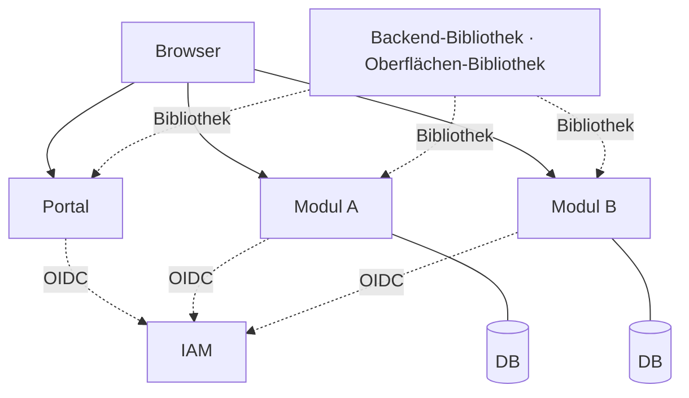

Ein Modul ist **ein Deployment**, das dreierlei zugleich ist: BFF für die Anmeldung, Auslieferung der eigenen Web-Oberfläche und eigenständig prüfende API. Weil Oberfläche und API dieselbe Herkunft teilen, entfallen CORS und ein Gateway. Alles Gemeinsame ist Bibliothek, kein laufender Dienst.

## Inhalt

| | |
|---|---|
| [1 Einführung und Ziele](#1-einführung-und-ziele) | Aufgabe, Qualitätsziele, Stakeholder |
| [2 Randbedingungen](#2-randbedingungen) | Gesetzte Regeln, Technologie, BSI-Bezug |
| [3 Kontextabgrenzung](#3-kontextabgrenzung) | Nachbarn: Nutzer, IAM, Datenbasis, Betrieb |
| [4 Lösungsstrategie](#4-lösungsstrategie) | Leitgedanke und was dadurch entfällt |
| [5 Bausteinsicht](#5-bausteinsicht) | Module und die geteilten Bibliotheken |
| [6 Laufzeitsicht](#6-laufzeitsicht) | Anmeldung, SSO, Token-Prüfung, Batch |
| [8 Querschnittliche Konzepte](#8-querschnittliche-konzepte) | Sitzung, Mandantentrennung, Protokollierung |
| [9 Architekturentscheidungen](#9-architekturentscheidungen) | E1–E11 mit Begründung und Preis |
| [11 Risiken und Praxisfallen](#11-risiken-und-praxisfallen) | Was real schiefgeht, nach Zeitpunkt sortiert |
| [12 Glossar](#12-glossar) | Begriff ↔ Bezeichner im Quelltext |

---

# 1. Einführung und Ziele

## 1.1 Aufgabenstellung

Eine Plattform aus mehreren fachlich unabhängigen **Modulen**. Jedes Modul bedient genau einen Datensatztyp aus der Datenbasis: **anzeigen**, **Änderung vormerken**, **prüfen und einreichen**.

Ein **Portal** listet die Module, auf die ein Nutzer Zugriff hat. Ein einmaliges Login gilt für alle Module. Nutzer können mehreren **Mandanten** zugeordnet sein; jeder Mandant sieht ausschließlich eigene Daten.

Was ein Modul tun kann – **wie** es das tut, ist Sache des Moduls und nicht Gegenstand dieses Dokuments:

| | |
|---|---|
| **Anzeigen** | Sätze des gewählten Mandanten suchen, sortieren, durchblättern |
| **Vormerken** | Eine gewünschte Änderung festhalten, ohne sie zu übergeben |
| **Prüfen und einreichen** | Vorgemerktes gemeinsam durchsehen und übergeben |
| **In Masse bearbeiten** | Eine Änderung für viele Sätze anstoßen und ihren Fortschritt verfolgen |
| **Nachweisen** | Jede fachliche Änderung in einer Prüfspur festhalten (8.4) |

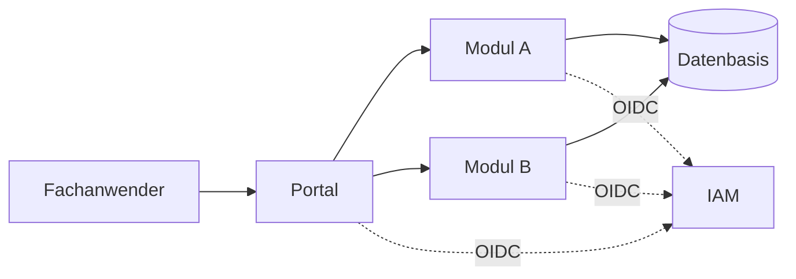

## 1.2 Qualitätsziele

| # | Ziel | Warum |
|---|---|---|
| 1 | **Mandantentrennung** | Datenleck zwischen Mandanten ist das Geschäftsrisiko ersten Ranges |
| 2 | **Einfachheit** | Wenige Bausteine, ein Muster – der Betrieb liegt bei einem separaten Team |
| 3 | **Unabhängige Module** | Neues Modul ergänzen, ohne bestehende anzufassen |
| 4 | **Nahtloses Login** | Modulwechsel ohne erneute Anmeldung |
| 5 | **Einheitliches Erscheinungsbild** | Getrennte Oberflächen, die sich wie eine Anwendung anfühlen |
| 6 | **BSI-Konformität** | Nachweisbare Umsetzung des IT-Grundschutzes |

## 1.3 Stakeholder

| Rolle | Erwartung |
|---|---|
| Fachanwender | Ein Login, klare Modulübersicht, verständliche Workflows |
| Modul-Teams | Autonomie in Fachlichkeit und Release-Takt |
| Betriebsteam | Alle Module betrieblich gleich; Deployment und Überwachung liegen bei ihm, nicht bei den Entwicklungsteams |
| Datenbasis-Team | Klar definierte, lastschonende Schnittstelle |

---

# 2. Randbedingungen

## 2.1 Betrieb ist ein anderes Team

Entwicklung und Betrieb sind getrennte Einheiten. Die Modul-Teams betreiben ihre Module nicht selbst.

| | Entwicklung | Betrieb |
|---|---|---|
| Fachlichkeit, Code, Tests, Artefakt bauen | ✔ | |
| Ausrollen, Überwachen, Rufbereitschaft | | ✔ |
| Datenbankbetrieb, Sicherung | | ✔ |
| Betriebshandbuch | liefert zu | führt |

## 2.2 Technisch

| # | Randbedingung | |
|---|---|---|
| 2.2.1 | **Unabhängige Module** | Jedes Modul ist eine vollständige Anwendung: Frontend, Backend, eigene Datenbank, eigenes Repository, eigener Release-Zyklus. |
| 2.2.2 | **Unabhängiges Deployment** | Ein Release von Modul A erfordert nie ein Deployment eines anderen Moduls oder des Portals. |
| 2.2.3 | **Eigene Datenbank je Modul** | Ein Modul greift ausschließlich auf seine eigene Datenbank zu. Fremdzugriff und gemeinsame Schemata sind verboten. Ein Modul ohne eigenen Zustand hat gar keine. |
| 2.2.4 | **Keine Modul-zu-Modul-Kommunikation** | Module rufen sich nicht gegenseitig auf; Navigation ist ein schlichter Verweis. Gemeinsames wird als **Bibliothek** geteilt, nie als laufender Dienst. |
| 2.2.5 | **Jeder Aufruf wird einzeln autorisiert** | Keine Anwendung vertraut einer anderen. Jeder API-Aufruf wird durch einen vollständig validierten Token autorisiert – **niemals** allein durch die Browser-Sitzung. |
| 2.2.6 | **Ein IAM je Umgebung** | Bestehender externer Identity-Provider, OpenID Connect, Authorization Code Flow. Weitere Identitätsquellen werden im IAM föderiert, nicht in der Anwendung konfiguriert. |
| 2.2.7 | **Kein für JavaScript lesbares Token** | Der Browser hält ein verschlüsseltes Sitzungs-Cookie – sonst nichts. Die Oberfläche kennt weder Token noch Ablaufzeit. |
| 2.2.8 | **Nur das originale IAM-Token** | Kein Token-Exchange, keine selbst ausgestellten Ersatz-Token, keine Transformation. |
| 2.2.9 | **Zustandslose Container** | Sitzungsdaten liegen verschlüsselt beim Client, Fachdaten in der Datenbank. Jeder Container ist jederzeit ersetzbar. |
| 2.2.10 | **Begrenztes Dienstangebot** | Private Cloud. Verfügbar: Kubernetes, relationale Datenbanken. **Nicht verfügbar**: Message-Broker, verteilter Sitzungsspeicher und vergleichbare Zusatzdienste. |
| 2.2.11 | **Massendaten als zeitgesteuerter Lauf** | Große Datenmengen werden nicht im Request verarbeitet. Wann und wie oft der Lauf startet, gehört der Laufzeitumgebung, nicht dem Modul. |
| 2.2.12 | **Kein Benutzerbestand** | Identitäten und Rollen führt allein der IAM. Das Modul speichert keine Nutzer – eine Kopie wäre eine zweite Wahrheit, die still veraltet. |
| 2.2.13 | **Fester Mandantenkatalog** | Ein Mandant ist eine Rolle `mandant_<id>`. Die Liste ist fest; es gibt keine Mandantenverwaltung im Modul. |

## 2.3 Technologie

Festgelegt sind die **Eigenschaften**, nicht die Produkte – außer dort, wo das Produkt bereits steht, weil es fremdbetrieben ist.

| Ebene | Festlegung |
|---|---|
| Oberfläche | Typisierte Web-Oberfläche, als eigenständiges Paket gebaut und vom Modul ausgeliefert |
| Backend | Rahmenwerk mit den Eigenschaften aus E11; eine Sprache für alle Module |
| Datenbank | Relational, je Modul eine |
| IAM | Gesetzt: der bestehende Identity-Provider der Umgebung (2.2.6) |
| Datenbasis | Gesetzt: Cloudera, fremdbetrieben (3.2) |
| Laufzeit | Container-Orchestrierung |

Alle Module verwenden **dieselbe** Wahl – Gleichförmigkeit ist Betriebsvoraussetzung (2.1). Begründung und Auswahlkriterien: Entscheidung E11.

## 2.4 BSI IT-Grundschutz

| Baustein | Thema | Verankert in |
|---|---|---|
| ORP.4 | Identitäts- und Berechtigungsmanagement | 8.1, 8.2 |
| APP.3.1 | Webanwendungen (Sitzung, Eingabeprüfung) | 8.1 |
| APP.4.4 / SYS.1.6 | Kubernetes und Containerisierung | 8.6 |
| OPS.1.1.2 | Ordnungsgemäße IT-Administration | 2.1 |
| OPS.1.1.5 / DER.1 | Protokollierung und Detektion | 8.4 |
| CON.8 | Software-Entwicklung | 8.6 |

Die Umsetzungsprüfung führt der ISB; dieses Dokument liefert die architektonische Grundlage.

---

# 3. Kontextabgrenzung

Was zum System gehört und was nicht. Alle drei Nachbarn sind **fremdbetrieben** – keiner davon wird von den Modul-Teams entwickelt oder betrieben.

## 3.1 Fachlicher Kontext

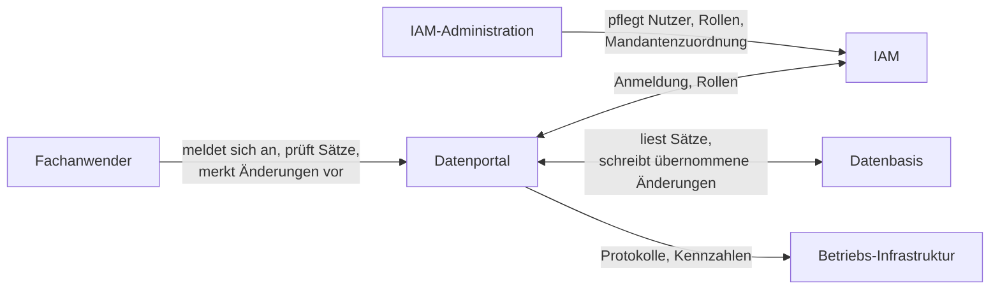

| Nachbar | Was ausgetauscht wird | Verantwortlich |
|---|---|---|
| **Fachanwender** | Anmeldung, Ansicht der Sätze eines Mandanten, Vormerkung und Einreichung von Änderungen, Status der Massenoperation | Fachbereich |
| **IAM** | Identität, Rollen, Mandantenberechtigung (`mandant_<id>`). Einzige Vertrauensinstanz | IAM-Team |
| **Datenbasis** | Die Datensätze selbst: gelesen bei jedem Seitenwechsel, geschrieben bei übernommenen Änderungen | Datenbasis-Team |
| **Betriebs-Infrastruktur** | Protokolle, Kennzahlen, Alarme; startet den zeitgesteuerten Lauf | Betriebsteam |

**Nicht im System**: Nutzerverwaltung (2.2.12), Mandantenverwaltung (2.2.13), Haltung der Datensätze (sie bleiben auf der Datenbasis, 3.2), Deployment und Überwachung (2.1).

## 3.2 Technischer Kontext

| Nachbar | Kanal | Authentisierung | Eigenheiten |
|---|---|---|---|
| Fachanwender | HTTPS, eigene Herkunft je Modul | verschlüsseltes Sitzungs-Cookie | Kein Token im Browser (2.2.7) |
| IAM (Keycloak) | HTTPS – OIDC Authorization Code Flow mit PKCE, `userinfo`, JWKS, Back-Channel-Logout | Client-Geheimnis je Modul | Ein OIDC-Client **je Modul** (E4), damit die Empfänger-Prüfung greift |
| Datenbasis (Cloudera) | **JDBC-Verbindung** | eigene Kennung des Moduls – **kein OIDC** | siehe unten |
| Betriebs-Infrastruktur | stdout-Protokolle, Kennzahl-Endpunkt auf eigenem Port | – | Der Lauf wird von außen gestartet (2.2.11) |

### Der Token endet an der API des Moduls

Zur Datenbasis hin meldet sich das Modul **als es selbst** an, mit einer eng berechtigten Kennung: lesen, was das Modul sehen darf, schreiben nur die Spalten, die eine übernommene Änderung berührt. Der Nutzer-Token wird nicht weitergereicht, und es wird auch keiner für die Plattform beschafft. Die Berechtigung vergibt die Plattform (Ranger), nicht das Modul.

### Die Datenbasis ist nicht die Datenbank des Moduls

Alles, was das Modul selbst verwaltet – Aufträge, Prüfspur, Mandantenregeln – gehört in seine **eigene** Datenbank und niemals in die Datenbasis. Umgekehrt hält das Modul **keine Kopie der Sätze**: Die Liste wird bei jedem Seitenwechsel dort gesucht, sortiert und geschnitten. Das ist spürbar langsamer als eine eigene Kopie – bewusst gezahlt, denn eine Kopie wäre eine zweite Wahrheit, die still veraltet. Dieselbe Begründung wie bei 2.2.12.

Die Eigenheiten der Verbindung – Transaktionsverhalten, Speicherform, Rückmeldungen beim Schreiben – sind mit dem Datenbasis-Team abzustimmen.

## 3.3 Was der IAM je Modul bereitstellen muss

Ohne diese Punkte startet das Modul zwar, aber die Anmeldung oder die Autorisierung schlägt fehl – meist auf eine Art, die nach einem Fehler in der Anwendung aussieht (Kapitel 11).

| Punkt | Anforderung |
|---|---|
| Client | **Einer je Modul**, vertraulich (mit Geheimnis), Authorization Code Flow **mit PKCE** |
| Empfänger-Angabe | Die Client-ID des Moduls muss im **Access-Token** stehen. Viele IAM tun das nicht von sich aus und brauchen einen eigenen Zuordner |
| Rollen | Am **userinfo-Endpunkt** verfügbar, nicht nur im Token (8.1) |
| Rückkehradressen | Rücksprungpfad des Moduls; in der Entwicklung zusätzlich der Port des Entwicklungsservers |
| Abmeldung | Adresse für Back-Channel-Logout je Modul (6.7) |
| Standardangaben | Kennung, Name, E-Mail müssen im Token stehen |

**Rollenmodell**: Zwei getrennte Arten von Rollen, die nie vermischt werden.

| Art | Form | Beantwortet |
|---|---|---|
| Fachrolle | frei, z. B. `user`, `admin` | *Was* darf der Nutzer tun |
| Mandantenrolle | `mandant_<id>`, ein Eintrag je Mandant | *Wo* darf er es tun |

Die Nutzerauskunft (5.3) trennt beides: Sie nennt **nur die Fachrollen** und daneben die erlaubten Mandanten, bereits aufgelöst. Die Oberfläche sieht das Rollenpräfix nie.

---

# 4. Lösungsstrategie

## 4.1 Leitgedanke

> **Ein Modul ist ein Deployment, das BFF, Oberfläche und API zugleich ist.** Alles Gemeinsame ist Bibliothek, kein Dienst.

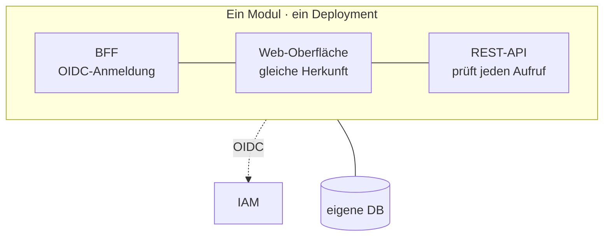

Weil die Oberfläche von ihrem eigenen Backend ausgeliefert wird, muss CORS nichts freigeben; Token-Weitergabe über Herkunftsgrenzen und ein Gateway-Baustein entfallen. Weil die API trotzdem nur validierte Token akzeptiert, wird auch innerhalb dieses einen Prozesses jeder Aufruf einzeln autorisiert.

## 4.2 Strategien je Qualitätsziel

| Ziel (1.2) | Ansatz | Ausgeführt in |
|---|---|---|
| Mandantentrennung | Mandant aus dem Token, bei jedem Zugriff erneut geprüft; Zugriffsregeln der Datenbank als zweite Linie | 8.2 |
| Einfachheit | Ein Bausteintyp, ein Deployment-Muster, eine Technologie-Vorgabe. Kein Gateway, kein Broker, kein zentraler Dienst | 5.1 |
| Unabhängige Module | Modul = Repository + Deployment + eigene Datenbank + eigener OIDC-Client. Kopplung nur über Bibliotheksversionen | 5.2 |
| Nahtloses Login | Jedes Modul führt seinen eigenen Anmeldevorgang; nahtlos wird er durch die Sitzung des IAM | 6.2 |
| Einheitliches Aussehen | Die Oberflächen-Bibliothek liefert Design-System und Kopfzeile – gemeinsames Erscheinungsbild ohne Laufzeitkopplung | 5.4 |
| BSI-Konformität | Token-Prüfung, Protokollierung und Härtung sind Vorgaben der Bibliothek, nicht Fleißarbeit je Modul | 8.1, 8.4, 8.6 |

## 4.3 Was dadurch entfällt

| Entfallen | Ersetzt durch |
|---|---|
| API-Gateway, zentraler Anmeldedienst | Eigene Herkunft je Modul, die Backend-Bibliothek in jedem Modul |
| CORS-Freigaben für fremde Herkünfte | Oberfläche und API teilen die Herkunft; der Filter listet nur diese eine |
| Event-Bus | Verschobene Verarbeitung in einem zeitgesteuerten Lauf |
| Zentraler Mandanten-, Audit- und Datenzugriffsdienst | Angaben aus dem Token, Tabellen je Modul, Bibliothek mit erzwungenem Mandantenfilter |

Übrig bleibt: **das Modul**. Der Preis dafür steht in 5.7 und E6.

---

# 5. Bausteinsicht

Was die Bausteine **sind**. Wie die Mechanik dahinter arbeitet – Sitzung, Token-Prüfung, Mandantentrennung, Batch – steht in Kapitel 8.

## 5.1 Bausteine

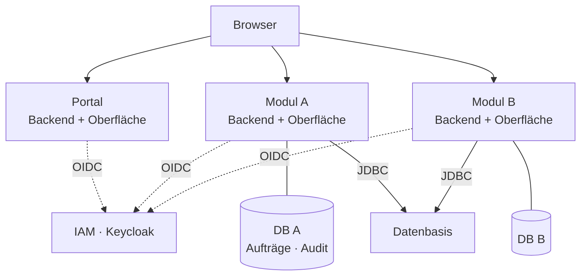

Es gibt nur **einen Bausteintyp: das Modul.** Das Portal ist ein Modul wie jedes andere, seine Fachlichkeit ist die Modulübersicht; eine eigene Datenbank braucht es dafür nicht.

Ein Modul ist **ein** Deployment, das dreierlei zugleich tut:

| Rolle | Umsetzung |
|---|---|
| **BFF** | Führt den OIDC Authorization Code Flow, hält die Sitzung |
| **Auslieferung der Oberfläche** | Serviert sein eigenes gebautes Oberflächenpaket – gleiche Herkunft, sodass CORS nichts freigeben muss |
| **Resource Server** | Stellt seine API bereit und validiert dort jeden Token vollständig (8.1) |

Diese Dreifaltigkeit in einem Prozess ist der Kern. Der CORS-Filter ist trotzdem eingeschaltet – nicht um etwas zu erlauben, sondern um alles Fremde abzuweisen. Die spätere Trennung von BFF und Resource Server bleibt möglich, ohne Code zu ändern; nur die Auslieferung ändert sich.

## 5.2 Repository-Schnitt

Jedes Modul und jede geteilte Bibliothek ist ein **eigenes Repository**. Kein Monorepo, keine gemeinsame Buildkette.

| Repository | Rolle |
|---|---|
| **Backend-Bibliothek** | Alle querschnittlichen Backend-Belange, als Abhängigkeit eingebunden (5.3) |
| **Oberflächen-Bibliothek** | Design-System und Anmeldevertrag der Oberfläche (5.4) |
| **Portal-Modul** | Launcher, ohne Datenbank |
| **Fachmodul** | Je Datensatztyp eines, mit eigener Datenbank |
| **Entwicklungsumgebung** | Lokaler IAM, Datenbanken und Datenbasis

## 5.3 Die Backend-Bibliothek

Eine gewöhnliche Bibliothek, kein eigener Rahmenwerks-Baustein: Wird sie eingebunden, ist die Anwendung ein plattformkonformes Modul – ohne dass ein Modul-Team Sicherheitscode schreibt. Entscheidend ist, dass das Jar **indiziert** ausgeliefert wird, sonst findet das Modul die enthaltenen Bausteine nicht und sie fehlen kommentarlos.

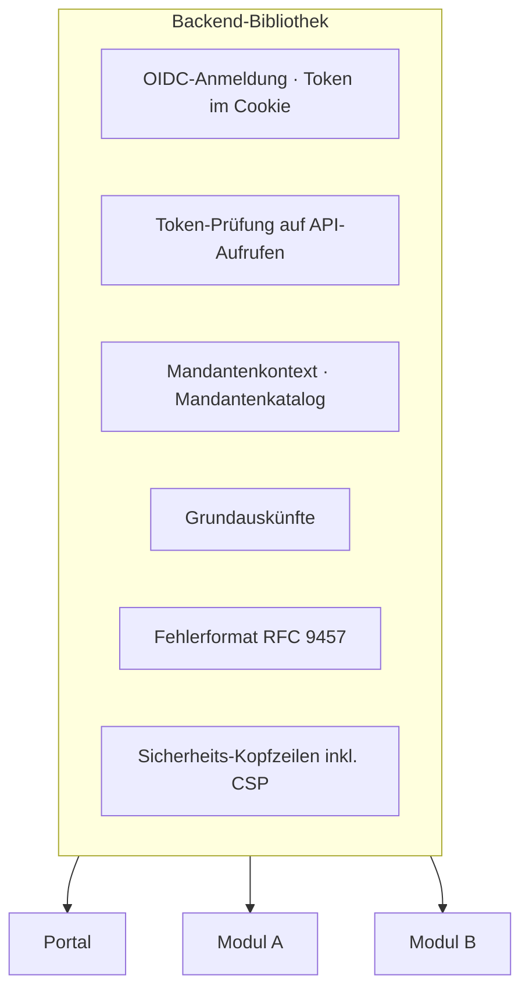

### Grundauskünfte

Jedes Modul beantwortet dieselben drei Fragen, ohne dass ein Modul-Team etwas dafür tut – die Oberfläche kann sich darauf verlassen:

| Auskunft | Inhalt |
|---|---|
| **Wer ist angemeldet** | Nutzer, Fachrollen und erlaubte Mandanten in einem Zug – **mandantenunabhängig**, also überall gleich und sauber zwischenspeicherbar |
| **Welches Modul** | Name, Baustand und die Adresse des Portals für den Zurück-Verweis. Reine Deployment-Angaben; der Baustand wird beim Bauen gesetzt, nicht zur Laufzeit ermittelt |
| **Abmeldung** | Beim Modul angestoßen, beim IAM vollzogen (6.5); dazu die Gegenstelle, über die das IAM eine anderswo beendete Sitzung meldet |

Eine Auskunft zum **Mandantenwechsel gibt es bewusst nicht**: Der Wechsel ist eine Entscheidung der Oberfläche (5.4), kein Serverzustand.

### Der Mandantenkatalog

Die **feste Liste der Mandanten samt Anzeigenamen liegt in dieser Bibliothek**, nicht in der Konfiguration der Module. Format: je Eintrag `<id>:<Anzeigename>`, kommagetrennt, in Anzeigereihenfolge. Ein **leerer** Katalog bricht den Start ab, statt jeden Nutzer stumm ohne Mandanten zu lassen. Nur so heißen und sortieren sie überall gleich; ein neuer Mandant ist eine Freigabe der Bibliothek. Berechtigungen enthält die Liste keine – sie liefert Name und Reihenfolge, alles Weitere entscheiden die Rollen (8.2). Die Oberfläche bekommt die Namen mit der Nutzerauskunft und hält damit keine eigene Kopie.

### Auslieferung der Oberfläche

Zwei Regeln, die man ohne Not falsch macht:

**Tiefe Verweise gehören der Oberfläche.** Ein Verweis auf eine Unterseite ist keine Datei – der Server liefert das Grundgerüst aus und die Oberfläche entscheidet, was sie zeigt. Serverseitige Pfade und Dateien bleiben davon ausgenommen, sonst bekommt ein Tippfehler im Skriptpfad eine Seite statt eines Fehlers und scheitert viel später mit einer irreführenden Meldung.

**Das Grundgerüst darf nicht zwischengespeichert werden.** Die übrigen Dateien tragen einen Inhaltsstempel im Namen und dürfen beliebig lange liegen bleiben; das Grundgerüst verweist auf sie. Wird es mitgespeichert, lädt der Browser nach einem Release weiter die alte Oberfläche gegen das neue Backend – nichts sieht kaputt aus, es verhält sich nur wie letzte Woche.

### Weiteres

| Thema | Festlegung |
|---|---|
| Fehlerformat | RFC 9457 `problem+json` – einheitlich über alle Module, ohne interne Details nach außen |
| Datenbankschema | Versionierte Schema-Migrationen je Modul |
| Erweiterbarkeit | Jede Vorgabe ist überschreibbar; ein Modul kann Einzelteile ersetzen, ohne die Bibliothek zu verlassen |

## 5.4 Die Oberflächen-Bibliothek

Eine Oberflächen-Bibliothek, ausgeliefert als **Quelltext**; das Modul kompiliert sie mit. Kein eigener Build-Schritt, keine vorkompilierte Fassung, die veralten kann.

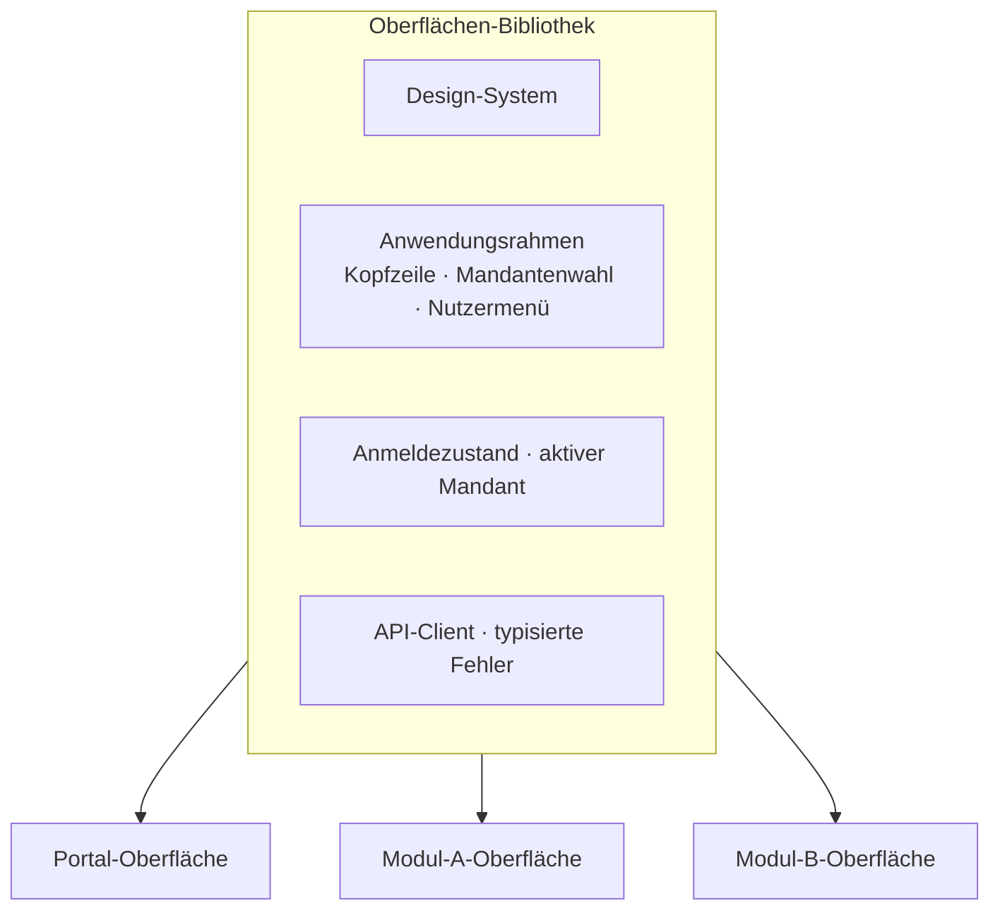

| Bereich | Inhalt | Warum geteilt |
|---|---|---|
| **Design-System** | Komponentensatz mit eingelegtem Quelltext, unter freier Lizenz | Einheitliches Erscheinungsbild ohne Laufzeitkopplung – der einzige Weg, bei getrennten Oberflächen ein gemeinsames Aussehen zu erreichen |
| **Anwendungsrahmen** | Kopfzeile mit Modulname, Mandantenwahl, Nutzermenü, Zurück-Verweis ins Portal | Der Nutzer erkennt dieselbe Anwendung, obwohl er das Modul gewechselt hat |
| **Kachel für den Launcher** | Darstellung eines Moduls in der Übersicht | Nur vom Portal genutzt, gehört aber zum gemeinsamen Aussehen |
| **Anmeldezustand** | Lädt die Nutzerauskunft vor dem ersten Rendern; wird sie abgelehnt, führt er in die Anmeldung. Hält den aktiven Mandanten und baut daraus die Pfade | Kein Modul baut eigene Anmeldelogik |
| **API-Client** | Zugriff ausschließlich auf die eigene Herkunft, wandelt `problem+json` in typisierte Fehler | Einheitliche Fehlerbehandlung; verhindert versehentliche Fremdaufrufe |

### Der Vertrag zwischen den Bibliotheken

Die einzige Kopplung der beiden Bibliotheken ist die **Auskunft über den angemeldeten Nutzer**: Kennung, Name, Fachrollen und die erlaubten Mandanten mit ihren Anzeigenamen. Ändert sich ihre Form, müssen beide Seiten neu ausgeliefert werden – deshalb ist sie bewusst klein gehalten und enthält insbesondere **keinen** aktiven Mandanten: Der ist Zustand der Oberfläche, nicht des Servers.

### Drei Eigenheiten, die man kennen muss

**An- und Abmeldung sind Seitenwechsel, keine Hintergrundaufrufe.** Die OIDC-Umleitungsketten müssen im Hauptfenster laufen; ein Hintergrundaufruf würde die Weiterleitungen verschlucken und die Anmeldung stillschweigend scheitern lassen.

**Der Mandantenwechsel ist reiner Oberflächenzustand.** Die Auswahl wird lokal gemerkt und in den Pfad der folgenden Aufrufe geschrieben – kein Aufruf, keine Sitzung, kein Neuladen. Sicher ist das, weil sie serverseitig ohnehin bei jedem Aufruf gegen die Rollen geprüft wird.

**Kein Token erreicht JavaScript.** Die Oberfläche kennt weder Token noch Ablaufzeit; eine abgelaufene Sitzung erkennt sie ausschließlich daran, dass ein Aufruf abgewiesen wird. Das hält den gesamten Sicherheitscode im Backend.

## 5.5 Was ausdrücklich **nicht** geteilt wird

| Nicht geteilt | Grund |
|---|---|
| Fachlogik, Domänenmodelle | Würde Module aneinander koppeln (2.2.4); jedes Modul schneidet seinen Datensatztyp selbst |
| Datenbankmodelle | Jedes Modul besitzt seine Datenbank allein (2.2.3) |
| Laufende Dienste | Wären Betriebsgegenstand, Ausfallpunkt und Vertrauensgrenze zugleich (E6) |

Die Grenze ist scharf: Geteilt wird, was **jedes** Modul gleich braucht und was nichts über Fachlichkeit weiß.

## 5.6 Modulaufbau

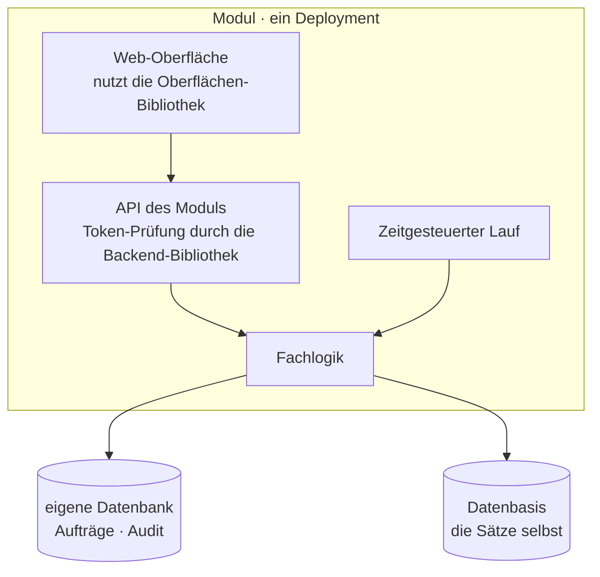

Der zeitgesteuerte Lauf nutzt dieselbe Fachlogik wie die API – keine zweite Implementierung.

## 5.7 Preis dieses Schnitts

Ohne zentralen Dienst gibt es nichts, was man einmal aktualisiert. Ein Sicherheitsfix in einer der beiden Bibliotheken erfordert ein Release **jedes** Moduls. Das ist der bewusst gezahlte Preis (E6); Umgang damit in Kapitel 11.

---

# 6. Laufzeitsicht

Die Abläufe. Warum sie so aussehen, steht in Kapitel 8; was dabei schiefgeht, in Kapitel 11.

## 6.1 Anmeldung

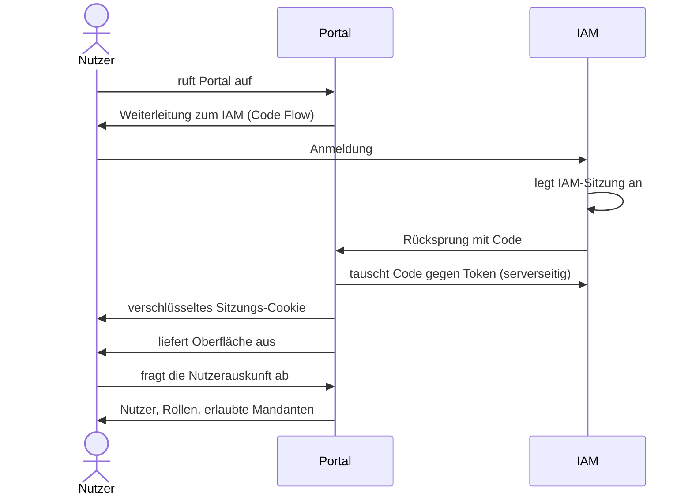

Der Browser erhält nie einen Token. Die Oberfläche rendert erst, wenn die Nutzerauskunft beantwortet ist; welcher Mandant davon aktiv ist, entscheidet sie selbst (5.4).

## 6.2 Modulwechsel – hier entsteht SSO

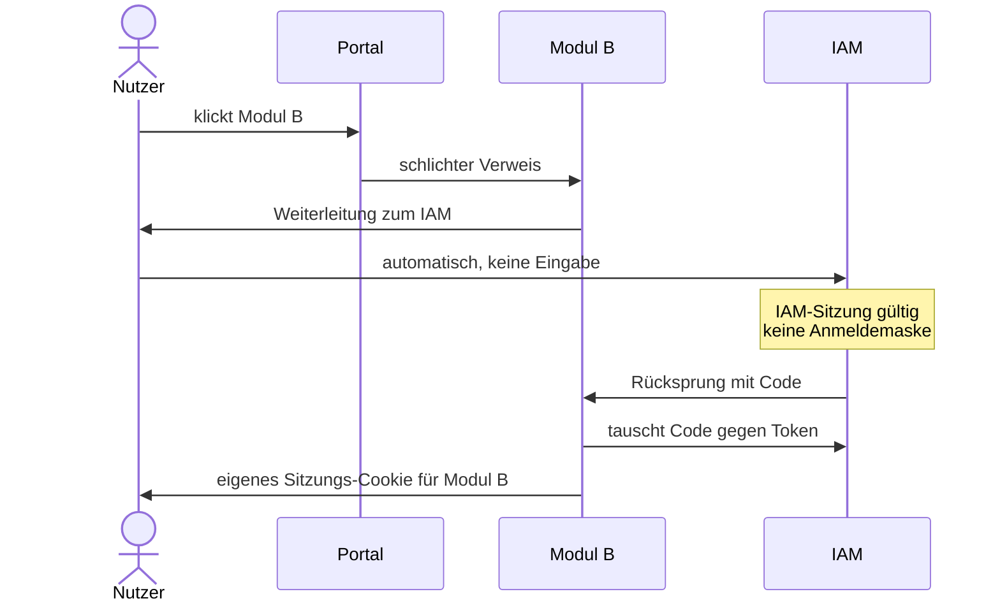

Zwei unsichtbare Weiterleitungen, kein Login-Dialog – SSO entsteht durch die Sitzung des IAM, nicht durch einen gemeinsamen Dienst.

## 6.3 Jeder API-Aufruf

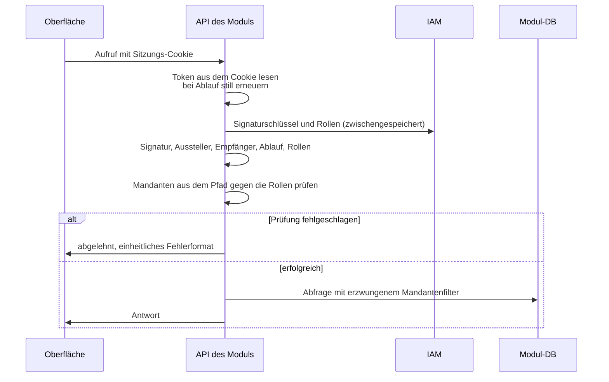

Entscheidend: Die Sitzung liefert nur den Token, sie autorisiert nichts.

## 6.4 Mandantenwechsel

Der Wechsel selbst kostet keinen Aufruf. Weil der Mandant im Pfad steht, ist die Antwort je Mandant zwischenspeicherbar.

## 6.5 Abmeldung

Die Abmeldung wirkt in **allen** Modulen: Das IAM ruft jedes beteiligte Modul direkt auf – Server zu Server, ohne Browser. Das Modul prüft die Signatur des Logout-Tokens und merkt die Sitzung vor; der nächste Aufruf des Nutzers findet den Vermerk, verwirft das Cookie und beginnt eine neue Anmeldung.

Der Vermerk hält nur den Bezeichner der abgemeldeten Sitzung, für Minuten – ein Zwischenspeicher, keine Sitzungsablage, damit bleibt 2.2.9 gewahrt. Die verbleibende Lücke bei mehreren Replikaten: Kapitel 11.

---

# 8. Querschnittliche Konzepte

Die Mechanik hinter den Bausteinen aus Kapitel 5. Alles hier ist in den beiden geteilten Bibliotheken umgesetzt, nicht in den Modulen einzeln.

## 8.1 Anmeldung, Sitzung, Autorisierung

### Zwei Betriebsarten in einem Prozess

Der Browser hält ausschließlich ein Cookie – einen Bearer-Token gibt es dort nicht (2.2.7). Die Anmeldung läuft deshalb für **alle** Pfade als Authorization Code Flow; unterschieden wird nicht der Mechanismus, sondern die Antwort:

| Pfad | Betriebsart | Verhalten bei fehlendem oder ungültigem Token |
|---|---|---|
| API-Aufruf | Resource Server | **Abweisung statt Umleitung** – die Umleitung zum IAM wird verworfen, damit die Oberfläche die Anmeldung selbst anstoßen kann |
| Seitenaufruf | BFF (Code Flow) | Weiterleitung zum IAM, danach Auslieferung der Oberfläche |

Das ist der Grund, warum die Prüfung auch **innerhalb** eines Moduls greift: Geprüft wird bei jedem Aufruf der **Access-Token** aus dem Cookie, nicht nur der ID-Token. Die Sitzung liefert den Token, autorisiert aber nichts.

### Sitzung: Token verschlüsselt im Cookie

Das Rahmenwerk legt ID-, Access- und Refresh-Token verschlüsselt im Cookie ab; der Container bleibt damit zustandslos (E2). Cookies über 4 KB teilt es selbst auf und setzt sie beim Rücksprung wieder zusammen – die Größenfrage ist Sache der Bibliothek, nicht jedes Moduls. Auflagen:

| Auflage | Ohne das |
|---|---|
| Verschlüsselungsschlüssel explizit setzen, über alle Repliken gleich | Jede Replik erzeugt einen eigenen zufälligen Schlüssel und kann fremde Cookies nicht lesen – Nutzer werden scheinbar zufällig abgemeldet |
| Cookie-Namen je Modul verschieden | Module überschreiben sich gegenseitig die Sitzung; Cookies ignorieren Portnummern |
| `HttpOnly`, `Secure`, `SameSite=Lax` | `Lax` statt `Strict`, weil der OIDC-Rücksprung ein Wechsel der Herkunft ist |
| CORS-Filter mit nur der eigenen Herkunft | Zweite, vom Cookie unabhängige Sperre gegen fremde Absender |
| Kurze Token-Laufzeit mit stiller Erneuerung | Begrenzt das Zeitfenster eines entwendeten Cookies |
| Strenge Content-Security-Policy | XSS ist die verbleibende Hauptgefahr: Das Cookie ist nicht lesbar, aber mitnutzbar |

### Sicherheits-Kopfzeilen

Auf **jeder** Antwort, auch auf der ausgelieferten Oberfläche – die läuft an der API vorbei und würde sonst ungeschützt bleiben:

| Kopfzeile | Wert | Wofür |
|---|---|---|
| `Content-Security-Policy` | nur eigene Herkunft; keine fremden Skripte, keine Einbettung | XSS – die Hauptgefahr, sobald das Cookie unlesbar ist |
| `X-Content-Type-Options` | `nosniff` | Kein Raten des Inhaltstyps |
| `X-Frame-Options` | `DENY` | Kein Einbetten in fremde Seiten |
| `Referrer-Policy` | `same-origin` | **Nicht** `no-referrer`: sonst sendet der Browser beim Absenden eines Formulars `Origin: null` und das Modul weist seine eigene Abmeldung ab |
| `Strict-Transport-Security` | nur hinter TLS gesetzt | Sonst bräche die Entwicklung über HTTP |

### CSRF ohne Token

Kein Token-Mechanismus, sondern zwei voneinander unabhängige Sperren: Das Sitzungs-Cookie ist `SameSite=Lax` und wird bei einem fremden Absender gar nicht erst mitgeschickt; der CORS-Filter weist eine fremde Herkunft schon vor der Verarbeitung ab.

**Bedingung**: Jede ändernde Operation bleibt eine **Nicht-GET-Methode** – bei einem Seitenaufruf per GET schickt der Browser das Cookie sehr wohl mit. Das ist die einzige Regel, auf der dieser Schutz ruht (siehe 11.2).

### Rollen aus dem userinfo-Endpunkt

Rollen werden am **userinfo-Endpunkt** erfragt, nicht aus dem Token gelesen: Ein Entzug wirkt damit, ohne auf den Ablauf des Tokens zu warten. Die Antwort wird kurz zwischengespeichert, sonst kostet jeder Aufruf eine IAM-Anfrage. Das Benutzerobjekt wird je Request daraus gebaut und nie gespeichert (2.2.12).

### Prüfreihenfolge

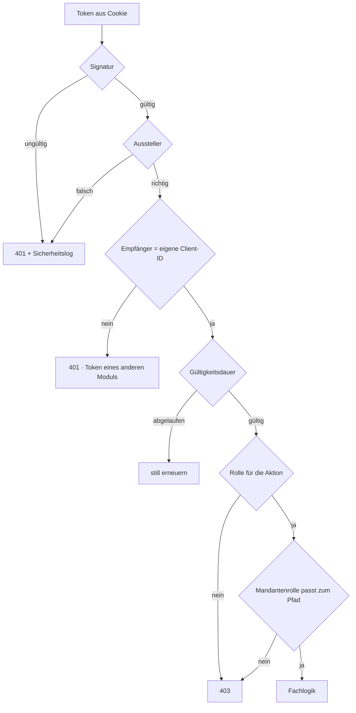

| Schritt | Erfahrungswert |
|---|---|
| **Empfänger prüfen** | Der am häufigsten übersehene Schritt. Ohne ihn ist ein Token von Modul A bei Modul B gültig – die Trennung der Module ist damit faktisch aufgehoben. Im IAM ist dafür ein eigener Zuordner je Client nötig – ohne ihn wird **jeder** Token abgelehnt. Negativtest fest im Build verankern |
| **Signaturschlüssel zwischenspeichern** | Ohne Zwischenspeicher erzeugt jeder Aufruf eine IAM-Anfrage. Neuladen nur bei unbekanntem Schlüsselkennzeichen, sonst bricht die Schlüsselrotation alle Module auf einmal |
| **Zeittoleranz** | Ohne Toleranz führt geringer Uhrenversatz zu sporadischen 401, die sich nicht reproduzieren lassen |
| **Signaturverfahren festnageln** | Nie aus dem Token übernehmen |

## 8.2 Mandantentrennung

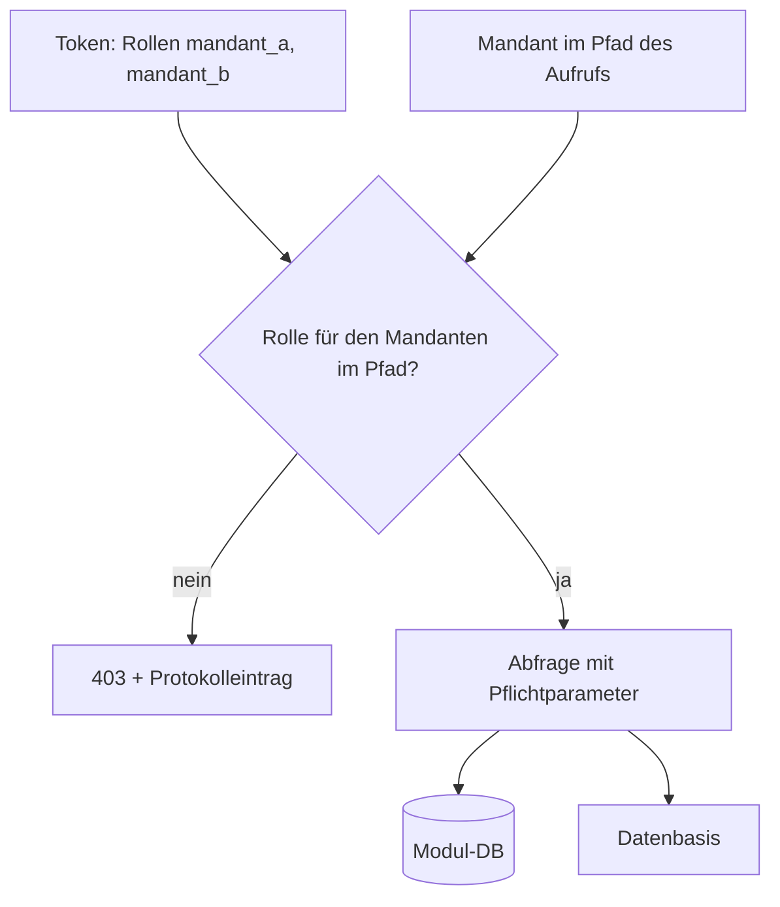

Der Mandant steht **im Pfad**, nicht im Serverzustand – das ist die Voraussetzung für Zwischenspeicherung: Jede Antwort hat ihren eigenen Schlüssel, und kein Zwischenspeicher muss über ein Cookie urteilen, in das er nicht hineinsehen kann.

- Quelle der Wahrheit ist der **Token**: Der Mandant kommt aus dem Browser, gilt aber nur, wenn der Token die Rolle `mandant_<id>` führt. Gewählt wird er von der Oberfläche, **geglaubt wird ihm nie**.
- Der Mandant ist Pflichtparameter jeder Abfrage – ein Aufruf ohne ihn schlägt fehl, statt versehentlich alles zu liefern.
- Mandanten-Kennung ist Pflichtspalte und **erste** Spalte jedes Index.

### Zweite Verteidigungslinie in der Datenbank

Ein Filter im Anwendungscode wird irgendwann in einem neuen Endpunkt vergessen – nicht aus Nachlässigkeit, sondern weil jemand die Regel nicht kannte. Deshalb erzwingt die Datenbank sie zusätzlich über zeilenbasierte Zugriffsregeln (E9):

| Regel | Wirkung |
|---|---|
| Zugriffsregel je Tabelle aktiv | Vergessener Filter liefert **keine** Zeilen statt aller – aus dem stillen Datenleck wird ein sichtbarer Fehler |
| Regel auch für den Eigentümer erzwingen | Sonst umgeht ausgerechnet der Anwendungsbenutzer sie |
| Anwendung verbindet sich **unprivilegiert** | Ein Datenbank-Superuser umgeht die Regeln bedingungslos – die zweite Linie wäre still abgeschaltet, während alle Tests grün bleiben |
| Mandant **je Transaktion** setzen, nicht je Verbindung | Bei Verbindungs-Pooling bliebe er sonst an der Verbindung kleben und der nächste Nutzer erbte ihn – die gefährlichste Ausprägung dieses Fehlers |
| Negativtest im Build | Abfrage ohne gesetzten Mandanten muss leer bleiben |

**Wie der Mandant an die Datenbank kommt**: Die Anwendung setzt ihn zu Beginn jeder Transaktion in eine **transaktionsgebundene** Variable; die Zugriffsregel jeder Tabelle vergleicht die Mandantenspalte damit. Transaktionsgebunden ist der Kern: An der Verbindung gebunden überlebt der Wert die Rückgabe in den Pool und der nächste Nutzer erbt ihn. Ist die Variable nicht gesetzt, liefert jede Abfrage null Zeilen – genau das prüft der Negativtest.

**Reichweite**: Diese zweite Linie liegt in der Datenbank des Moduls und schützt genau das, was dort liegt – Aufträge und Prüfspur. Die Sätze selbst liegen auf der Datenbasis, die keine solchen Regeln kennt. Für sie tragen zwei andere Dinge: der Mandant als Pflichtprädikat jeder Abfrage und die Berechtigung des Modul-Prinzipals auf der Plattform (3.2). Wer die Trennung dort ebenso zweifach absichern will, muss das mit dem Plattform-Team vereinbaren.

## 8.3 Massendaten

Große Datenmengen werden **nicht im Request** verarbeitet (2.2.11): Der Aufruf nimmt den Wunsch entgegen und antwortet sofort, die Arbeit geschieht später in einem zeitgesteuerten Lauf desselben Moduls. Ein Broker steht dafür nicht zur Verfügung (2.2.10).

Zwei Regeln gelten dabei plattformweit, alles Weitere entscheidet das Modul:

| Regel | Warum |
|---|---|
| Der Lauf wird **von außen** angestoßen | Kein Zeitplaner im Prozess und kein Endpunkt, der Arbeit auslöst – wann und wie oft gehört der Laufzeitumgebung |
| Der Lauf ist von der Mandantentrennung **nicht ausgenommen** | Er unterliegt denselben Zugriffsregeln wie ein Nutzeraufruf (8.2) |

## 8.4 Protokollierung

| Ebene | Inhalt | Ziel |
|---|---|---|
| Audit | Wer, wann, welcher Mandant, welcher Datensatz, welche Aktion | Nur einfügbare Tabelle je Modul |
| Sicherheit | Abgelehnte Anmeldungen und Mandantenzugriffe, ungültige Token | Eigener Logger → Betriebs-Infrastruktur (OPS.1.1.5, DER.1) |
| Betrieb | Fehler, Antwortzeiten, Ergebnisse der Batch-Läufe | Log und Kennzahlen → Überwachung |

Keine Token und keine personenbezogenen Nutzdaten im Log. Vorgangsnummer von Anfang an durchreichen – nachträglich ist das teuer.

## 8.5 Fehler und Schnittstellen

Einheitliches Fehlerformat nach RFC 9457 (`problem+json`), in der Oberfläche als typisierter Fehler verfügbar. Nach außen nur allgemeine Meldungen mit Vorgangsnummer – keine internen Details (BSI APP.3.1).

REST/JSON, **ohne Versionsangabe im Pfad**: Jede Oberfläche wird von ihrem eigenen Backend ausgeliefert, beide gehen also immer gemeinsam in Betrieb – es gibt keinen fremden Aufrufer, für den eine alte Fassung offen bleiben müsste. Sollte je eine Schnittstelle für Dritte geöffnet werden, ist die Pfadversionierung genau dort nachzurüsten.

Modulübergreifende Schnittstellen gibt es nicht; nur Oberfläche ↔ eigenes Backend und Backend ↔ Datenbasis (3.2).

## 8.6 Sicherheit im Betrieb

| Maßnahme | BSI |
|---|---|
| TLS-Zwang und Sicherheits-Kopfzeilen am Eingang | APP.3.1 |
| Netztrennung je Modul – kein Weg von Modul zu Modul | NET.1.1, APP.4.4 |
| Container ohne Root, ohne Zusatzrechte, mit schreibgeschütztem Dateisystem | SYS.1.6 |
| Geheimnisse getrennt von der Konfiguration, rotierbar | ORP.4 |
| Schwachstellenprüfung des Artefakts vor Betriebsübergabe | CON.8 |
| Datenbankbenutzer nur auf dem eigenen Schema berechtigt, ohne Superuser-Rechte | ORP.4 |

---

# 9. Architekturentscheidungen

## 9.1 Übersicht

| # | Entscheidung | Gewählt |
|---|---|---|
| E1 | Frontend-Integration | Portal als Launcher, Verweise statt Micro-Frontends |
| E2 | Sitzung | Token verschlüsselt im Cookie, kein Serverzustand |
| E3 | Eingangskomponente | Keine – Modul liefert eigene Oberfläche aus |
| E4 | OIDC-Clients | Einer je Modul |
| E5 | Mandantenkontext | Aus dem Token, Auswahl in der Oberfläche |
| E6 | Geteiltes | Bibliotheken statt Dienste |
| E7 | Asynchronität | Massendaten verschoben statt im Request verarbeitet |
| E8 | Abmeldung | RP-initiated plus Back-Channel-Logout |
| E9 | Zweite Linie Mandantentrennung | Zeilenbasierte Zugriffsregeln in der Datenbank |
| E10 | Betriebsmodell | Übergabe an das Betriebsteam, ein Muster für alle |
| E11 | Technologie | Auswahlkriterien statt Produktnamen; eine Wahl für alle Module |

Alle entschieden.

## 9.2 Im Einzelnen

### E1 — Portal als Launcher

Micro-Frontends erzeugen Laufzeitkopplung und Versionsabhängigkeiten zwischen Hülle und Modulen; das widerspricht unabhängigen Releases. Der Preis – ein spürbarer Anwendungswechsel – wird durch die gemeinsame Kopfzeile aus der Oberflächen-Bibliothek weitgehend aufgehoben.

### E2 — Token verschlüsselt im Cookie

Zustandslose Container (2.2.9) ohne verfügbaren Sitzungsspeicher (2.2.10) lassen keine serverseitige Sitzung zu, die ohne Zusatzdienst auskommt. Das Rahmenwerk muss die Token daher ab Werk verschlüsselt im Cookie ablegen und zu große Cookies selbst aufteilen – eine der Anforderungen aus E11.

**Preis**: Der Token ist technisch im Browser. Verbindlich bleibt, dass er für JavaScript nicht lesbar ist. Auflagen in 8.1, Restrisiko in 11.5. **Dem ISB vorzulegen.**

**Verworfen**: Serverseitige Sitzung – bräuchte klebende Sitzungen oder Replikation und damit Zustand im Container.

### E3 — Keine Eingangskomponente

Jedes Modul liefert seine Oberfläche selbst aus. Damit teilen Oberfläche und API dieselbe Herkunft: keine Freigabe fremder Herkünfte nötig, kein Gateway, ein Baustein weniger. Ein Gateway hätte keine eigene Aufgabe, da die Autorisierung ohnehin je Modul stattfindet.

### E4 — Ein OIDC-Client je Modul

Zwingende Folge aus E3. Nebeneffekt: saubere Trennung der Empfänger-Angabe, wodurch die Prüfung aus 8.1 überhaupt erst greifen kann, sowie klare Rechte- und Protokollzuordnung je Modul.

**Preis**: Das IAM-Team wird bei jedem neuen Modul tätig. Erfordert Standardvorlage und feste Vorlaufzeit.

### E5 — Mandant aus dem Token

Kein eigener Mandantendienst. Der IAM ist ohnehin Vertrauensinstanz; zwei Quellen der Wahrheit wären ein Risiko. Die Auswahl merkt sich allein die Oberfläche.

**Preis**: Änderungen an der Zuordnung wirken erst, wenn die Rollen neu erfragt werden – der userinfo-Zwischenspeicher (8.1) hält die Verzögerung bei Minuten statt bei der Token-Laufzeit.

### E6 — Bibliotheken statt Dienste

Jeder zentrale Dienst wäre Betriebsgegenstand, Ausfallpunkt und weitere Vertrauensgrenze zugleich. Bei getrenntem Betrieb (2.1) wiegt das schwerer als Wiederverwendung zur Laufzeit.

**Preis**: Ein Sicherheitsfix erfordert ein Release **jedes** Moduls. Umgang in 11.4.

### E7 — Massendaten verschoben

Kein Broker verfügbar (2.2.10), und ein Request darf nicht auf eine Massenverarbeitung warten. Der Wunsch wird deshalb entgegengenommen und später abgearbeitet. Verarbeitung startet zum nächsten Termin statt sofort – bei kurzen Intervallen unerheblich.

### E8 — Abmeldung

Vom Modul angestoßene Abmeldung beim IAM, **ergänzt um Back-Channel-Logout**: Das IAM ruft jedes Modul direkt auf, sodass eine Abmeldung überall wirkt und nicht nur dort, wo sie ausgelöst wurde.

Die Sorge, das brauche eine serverseitige Sperrliste, hat sich als kleiner erwiesen als befürchtet: Das Modul merkt sich nur den Bezeichner der abgemeldeten Sitzung, wenige Minuten lang. Ein Zwischenspeicher, keine Sitzungsablage – 2.2.9 bleibt gewahrt.

**Preis**: Der Vermerk lebt in dem Replikat, das das IAM aufgerufen hat. Restlücke und Gegenmittel in 11.5.

### E9 — Zugriffsregeln in der Datenbank

Der Filter im Anwendungscode allein reicht nicht; er wird irgendwann in einem neuen Endpunkt übersehen. Zeilenbasierte Regeln machen aus dem stillen Datenleck einen sichtbaren Fehler. Beim höchstrangigen Qualitätsziel ist eine zweite Linie den Aufwand wert.

### E10 — Übergabe an das Betriebsteam

Die Architektur passt sich der bestehenden Organisation an, statt ein Betriebsmodell zu erzwingen, das es nicht gibt. Folge: Einheitlichkeit über alle Module ist verbindlich, nicht optional.

### E11 — Auswahlkriterien für das Rahmenwerk

Nicht das Produkt ist die Entscheidung, sondern die Liste, die es erfüllen muss. Ein Rahmenwerk kommt in Frage, wenn es **alle** folgenden Punkte ohne Eigenbau abdeckt:

| Kriterium | Weil |
|---|---|
| Verschlüsselte Token-Ablage im Cookie, samt Aufteilung großer Cookies | E2 – sonst schreibt jedes Modul Sicherheitscode |
| Zwei OIDC-Betriebsarten in einem Prozess, nach Pfad unterschieden | E3, 8.1 – der Kern des Entwurfs |
| Auslieferung der gebauten Oberfläche aus demselben Artefakt | 5.1 – gleiche Herkunft, kein Gateway |
| Kurze Startzeiten, geringer Speicherbedarf | Zustandslose, häufig neu startende Container (2.2.9) |
| Rollen aus dem userinfo-Endpunkt, mit Zwischenspeicher | 8.1 |

Zwei Festlegungen, die aus der Vorarbeit stammen und bewusst so bleiben:

- Statt zweier Filterketten genügt **ein** Cookie-Flow, der API-Aufrufe abweist statt sie umzuleiten (8.1).
- Statt einer **serverseitigen Sitzung** trägt das verschlüsselte Cookie den Zustand (E2); der aktive Mandant liegt ganz in der Oberfläche.

Ein Wechsel des Rahmenwerks berührt die Oberflächen-Bibliothek **nicht**: Der Vertrag zwischen den Bibliotheken ist die HTTP-Schnittstelle, nicht die Technologie. Das Rahmenwerk bleibt austauschbar, solange es die Liste oben erfüllt.

## 9.3 Offene Punkte

| Punkt | Ansprechpartner |
|---|---|
| Freigabe der Cookie-Lösung | ISB |
| Rotation des Cookie-Schlüssels über mehrere Repliken | Betrieb, ISB |
| Mindestversion der Bibliotheken bei Sicherheitsfixes | Architektur, Modul-Teams |
| Schreibbarkeit der Tabellen und Rechte des Modul-Prinzipals in der Datenbasis (3.2) | Datenbasis-Team |

---

# 11. Risiken und Praxisfallen

Der Wert dieses Kapitels liegt in der Spalte **„Woran man es merkt"** – die Gegenmaßnahmen selbst stehen als Konzept in Kapitel 8.

## 11.1 Beim ersten Integrationstest

| Falle | Woran man es merkt | Gegenmaßnahme |
|---|---|---|
| **IAM ohne Empfänger-Zuordner.** Der Token trägt die Empfänger-Angabe nicht | **Jeder** API-Aufruf endet mit 401, obwohl die Anmeldung funktioniert | Zuordner je Client anlegen; gehört in die Client-Standardvorlage |
| **Rollen nicht am userinfo-Endpunkt freigegeben.** Sie stehen im Token, aber die Anwendung liest sie dort nicht (8.1) | Anmeldung klappt, der Nutzer hat aber keine Mandanten und sieht nichts | Den Rollen-Zuordner ausdrücklich auch für userinfo freigeben |
| **Eingespielte IAM-Konfiguration verdrängt die Standard-Geltungsbereiche.** Wer beim Import eigene mitliefert, unterdrückt die automatisch angelegten | Der Token wirkt vollständig, es fehlen aber Kennung, Name, E-Mail oder die Rollen – Fehler zeigen sich erst weiter hinten | Die Standard-Geltungsbereiche im Import ausdrücklich mitführen und nach jedem Import einen Token stichprobenartig prüfen |
| **Gleiche Cookie-Namen in mehreren Modulen.** Cookies ignorieren Portnummern | Die Anmeldung in Modul B meldet aus Modul A ab. Wirkt wie ein Sitzungsfehler, ist aber Namensgleichheit | Cookie je Modul eindeutig benennen. Betrifft auch Produktion, sobald Module sich eine Domäne teilen |
| **Cookie-Verschlüsselungsschlüssel nicht gesetzt** | Mit einer Replik unauffällig, mit zweien werden Nutzer scheinbar zufällig abgemeldet | Schlüssel fest vorgeben, über alle Repliken gleich |
| **Uhrenversatz** | Vereinzelte 401, nicht reproduzierbar | Zeittoleranz bei der Gültigkeitsprüfung |

## 11.2 Kurz nach dem Produktivgang

| Falle | Woran man es merkt | Gegenmaßnahme |
|---|---|---|
| **Empfänger wird nicht geprüft.** Ein Token von Modul A ist bei Modul B gültig – die Trennung der Module ist faktisch aufgehoben | **Gar nicht.** Nur ein gezielter Test oder ein Angreifer findet es | Negativtest fest im Build: Token von A gegen B senden, 401 erwarten. **Höchstes Einzelrisiko dieser Architektur** |
| **Mandantenfilter im neuen Endpunkt vergessen** | Ein Nutzer sieht fremde Daten – der schlimmste denkbare Fehler | Zweite Linie in der Datenbank (E9). Allein auf Code-Reviews zu setzen, ist eine Frage der Zeit |
| **Anwendung läuft als Datenbank-Superuser** | Nichts – alle Tests bleiben grün, während die zweite Linie still abgeschaltet ist | Unprivilegierte Rolle erzwingen, Negativtest im Build (8.2) |
| **Verbindungs-Pool erbt den Mandanten** | Sporadisch falsche Daten, lastabhängig, extrem schwer zu finden | Mandant je Transaktion setzen, nicht je Verbindung |
| **Sitzungskennung rotiert bei jedem Aufruf.** Eine zu strenge Zustandslos-Einstellung erneuert die Sitzung pro Aufruf | Parallele Aufrufe der Oberfläche scheitern sporadisch | Auf der API-Seite den Sicherheitskontext nur für die Dauer des Aufrufs halten |
| **Ändernde Operation per GET erreichbar.** Der CSRF-Schutz beruht allein auf `SameSite=Lax`, und `Lax` schickt das Cookie bei einem Seitenaufruf per GET sehr wohl mit | Nichts – die Lücke ist unsichtbar, bis jemand sie sucht | Ändernde Endpunkte ausnahmslos als Nicht-GET führen; im Review darauf prüfen |

## 11.3 Nach einigen Wochen

| Falle | Woran man es merkt | Gegenmaßnahme |
|---|---|---|
| **Zeitgesteuerter Lauf ist still gestorben.** Nach einer Störung der Steuerungsebene wird er bei zu vielen verpassten Terminen dauerhaft nicht mehr eingeplant | Nichts – keine Fehlermeldung, keine Kennzahl. Der Fachbereich meldet sich | Auf „letzter erfolgreicher Lauf älter als X" alarmieren. **Das Ausbleiben überwachen, nicht den Fehler** |
| **Batchläufe belasten die Datenbasis** | Beschwerden anderer Nutzer der Plattform | Zeitpläne versetzen, Drosselung in der Bibliothek, Absprache mit dem Plattform-Team |

## 11.4 Nach einigen Monaten

| Falle | Woran man es merkt | Gegenmaßnahme |
|---|---|---|
| **Bibliotheksfix erreicht nicht alle Module** | Bei der nächsten Prüfung: drei Module auf drei Versionsständen | Mindestversion mit Frist, automatische Prüfung im Build. Bewusst gezahlter Preis von E6 |
| **Kein durchgehender Vorgangsbezug** | Beim ersten modulübergreifenden Vorfall lässt sich der Weg eines Aufrufs nicht rekonstruieren | Vorgangsnummer von Anfang an durchreichen – nachträglich ist das teuer |

## 11.5 Dauerhaft

| Falle | Gegenmaßnahme |
|---|---|
| **XSS trotz nicht lesbarem Cookie.** Das Cookie ist für JavaScript unsichtbar, ein eingeschleustes Skript kann aber Aufrufe im Namen des Nutzers absetzen | Strenge Content-Security-Policy, konsequente Ausgabekodierung, Abhängigkeitsprüfung, Penetrationstest vor Produktivgang. **Hauptrisiko von E2** |
| **Abmelde-Lücke bei mehreren Replikaten.** Back-Channel-Logout ist umgesetzt, aber das IAM ruft nur ein Replikat auf. Wer danach auf einem anderen landet, behält sein Cookie bis zum Ablauf | Kurze Token-Laufzeit. Schließen ließe sich die Lücke mit einem geteilten Zwischenspeicher – neuer Zusatzdienst, deshalb bewusst nicht jetzt |

## 11.6 Technische Schulden

| Schuld | Warum akzeptiert | Wann neu bewerten |
|---|---|---|
| Token im Cookie statt serverseitiger Sitzung | Zustandslosigkeit ohne Zusatzdienst | Sobald ein Sitzungsspeicher verfügbar ist |
| Bibliothekslogik in jedem Modul | Kein zusätzlicher Betriebsgegenstand | Ab etwa fünf Modulen |
| Mandantenbindung an die Datenbank liegt im Modul, nicht in der Backend-Bibliothek | Die Bibliothek muss ohne Datenbank nutzbar bleiben – das Portal hat keine | Sobald ein zweites Modul mit Datenbank existiert |

---

# 12. Glossar

Die Dokumentation ist deutsch, der Quelltext englisch. Diese Tabelle ist die Brücke – sie nennt zu jedem Begriff den Bezeichner, unter dem er im Code auftaucht.

| Begriff | Im Code | Bedeutung |
|---|---|---|
| **Modul** | `<fach>-app` | Ein Deployment, das BFF, Oberfläche und eigenständig prüfende API zugleich ist. Der einzige Bausteintyp (5.1) |
| **Portal** | `portal-app` | Modul, dessen Fachlichkeit die Modulübersicht ist. Ohne Datenbank |
| **BFF** | – | Backend for Frontend: die serverseitige Hälfte der Anmeldung. Führt den Code Flow, hält die Token, gibt sie nie an den Browser |
| **Autorisierung je Aufruf** | – | Keine Anwendung vertraut einer anderen; autorisiert wird ausschließlich über einen vollständig geprüften Token, nie über die Sitzung (2.2.5) |
| **Mandant** | `tenant`, Rolle `mandant_<id>` | Die Datentrennungseinheit. Kein eigener Datensatz, sondern eine Rolle im IAM (2.2.13) |
| **Mandantenkatalog** | `TenantCatalog`, `platform.tenants` | Feste Liste der Mandanten mit Anzeigename und Reihenfolge, in der Backend-Bibliothek (5.3). Vergibt keine Rechte |
| **Aktiver Mandant** | `activeTenant` | Der gerade betrachtete Mandant – reiner Zustand der Oberfläche, nie Serverzustand (5.4) |
| **Empfänger** | `aud` / `audience` | Die Client-ID, für die ein Token ausgestellt wurde. Ihre Prüfung ist der am häufigsten übersehene Schritt (8.1) |
| **Aussteller** | `iss` / `issuer` | Der IAM, der den Token ausgestellt hat |
| **Vormerkung** | – | Eine gewünschte, noch nicht eingereichte Änderung. Gehört bis zum Einreichen dem Nutzer |
| **Auftrag** | – | Eine eingereichte Änderung; ab hier gehört sie dem Lauf |
| **Zeitgesteuerter Lauf** | – | Von außen angestoßene Verarbeitung außerhalb des Requests (8.3) |
| **Prüfspur / Audit** | – | Nur einfügbarer Nachweis je Modul: wer, wann, welcher Mandant, welcher Satz, welche Aktion (8.4) |
| **Zeilenbasierte Zugriffsregeln** | Row Level Security, `app.tenant_id` | Zweite Linie der Mandantentrennung in der Datenbank (E9) |
| **Datenbasis** | `datenplattform` *(Altname im Code)* | Führende Quelle der Datensätze. Cloudera, über JDBC angebunden, ohne OIDC (3.2) |
| **Satz / Datensatz** | `record` | Ein Eintrag des Datensatztyps, den ein Modul bedient. Liegt auf der Datenbasis, nie als Kopie im Modul |
| **IAM** | Keycloak | Identity and Access Management – die einzige Vertrauensinstanz (2.2.6) |
| **Grundauskünfte** | – | Nutzer, Modul und Abmeldung – was jedes Modul durch die Backend-Bibliothek automatisch bietet (5.3) |
| **Fehlerformat** | RFC 9457, `problem+json` | Einheitliches Fehlerformat über alle Module (8.5) |
| **ISB** | – | Informationssicherheitsbeauftragter; prüft die Umsetzung der BSI-Anforderungen (2.4) |
