# Architekturdokumentation – Zentraler Anwendungsrahmen

Die Plattform besteht aus unabhängigen Modulen. Jedes Modul bedient einen Datensatztyp aus der Datenbasis: anzeigen, verifizieren, Änderungen dazu beantragen und sie in Masse bearbeiten. Ein Portal listet die Module auf. Die Anmeldung läuft über den bestehenden IAM, eine Anmeldung gilt für alle Module. Die Plattform ist mehrmandantenfähig und am BSI-Grundschutz ausgerichtet. Jedes Modul autorisiert jeden Aufruf selbst.

## Der Kerngedanke

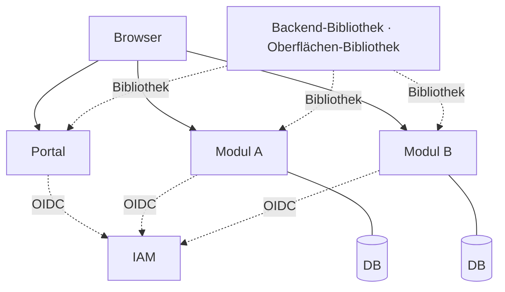

Der zentrale Anwendungsrahmen ist kein laufender Dienst. Er besteht aus den beiden geteilten Bibliotheken (5.3, 5.4). Ein Modul bindet sie ein und ist damit plattformkonform: Anmeldung, Mandantentrennung, Erscheinungsbild und Betriebsauskünfte sind dann vorhanden. Der Rahmen wird zentral gepflegt, läuft aber nicht an zentraler Stelle.

Ein Modul ist ein Deployment mit drei Aufgaben: BFF für die Anmeldung, Auslieferung der eigenen Web-Oberfläche und eine API, die jeden Aufruf selbst prüft. Oberfläche und API teilen dieselbe Origin. Deshalb sind keine CORS-Freigaben und kein Gateway nötig.

## Inhalt

| | |
|---|---|
| [1 Einführung und Ziele](#1-einführung-und-ziele) | Aufgabe, Qualitätsziele, Stakeholder |
| [2 Randbedingungen](#2-randbedingungen) | Gesetzte Regeln, Technologie |
| [3 Kontextabgrenzung](#3-kontextabgrenzung) | Nachbarn: Nutzer, IAM, Datenbasis, Betrieb |
| [4 Lösungsstrategie](#4-lösungsstrategie) | Leitgedanke und Strategien je Qualitätsziel |
| [5 Bausteinsicht](#5-bausteinsicht) | Module und die geteilten Bibliotheken |
| [6 Laufzeitsicht](#6-laufzeitsicht) | Anmeldung, SSO, Token-Prüfung, Batch |
| [7 Verteilungssicht](#7-verteilungssicht) | Artefakte, Konfiguration und Start des Batchlaufs |
| [8 Querschnittliche Konzepte](#8-querschnittliche-konzepte) | Sitzung, Mandantentrennung, Logging, Betrieb |
| [9 Architekturentscheidungen](#9-architekturentscheidungen) | E1–E12 mit Begründung und Preis |
| [10 Qualitätsszenarien](#10-qualitätsszenarien) | Verbindliche Abnahmeszenarien |
| [12 Glossar](#12-glossar) | Begriff ↔ Bezeichner im Quelltext |

---

# 1. Einführung und Ziele

## 1.1 Aufgabenstellung

Eine Plattform aus mehreren fachlich unabhängigen **Modulen**. Jedes Modul bedient genau einen Datensatztyp aus der Datenbasis: **anzeigen**, **Änderung vormerken**, **prüfen und einreichen**.

Ein **Portal** listet die Module, auf die ein Nutzer Zugriff hat. Ein einmaliges Login gilt für alle Module. Nutzer können mehreren **Mandanten** zugeordnet sein; jeder Mandant sieht ausschließlich eigene Daten.

Was ein Modul tun kann. Wie es das tut, entscheidet das Modul:

| | |
|---|---|
| **Anzeigen** | Datensätze des gewählten Mandanten suchen, sortieren, durchblättern |
| **Vormerken** | Eine gewünschte Änderung festhalten, ohne sie zu übergeben |
| **Prüfen und einreichen** | Vorgemerktes gemeinsam durchsehen und übergeben |
| **In Masse bearbeiten** | Eine Änderung für viele Datensätze anstoßen und ihren Fortschritt verfolgen |
| **Nachweisen** | Jede fachliche Änderung in einem Audit Trail festhalten (8.4) |

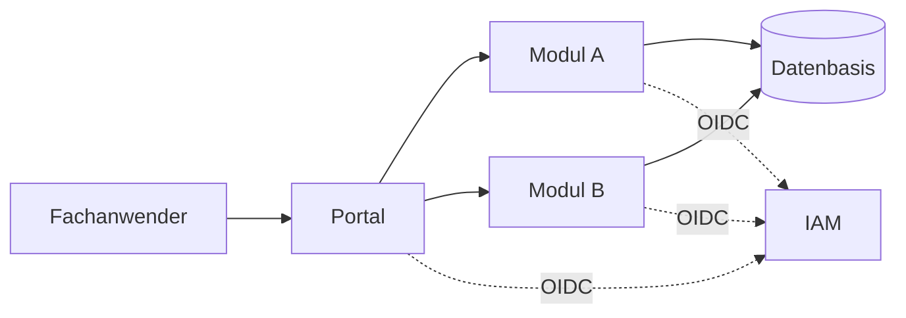

## 1.2 Qualitätsziele

| # | Ziel | Warum |
|---|---|---|
| 1 | **Mandantentrennung** | Datenleck zwischen Mandanten ist das Geschäftsrisiko ersten Ranges |
| 2 | **Einfachheit** | Wenige Bausteine, ein Muster – der Betrieb liegt bei einem separaten Team |
| 3 | **Unabhängige Module** | Neues Modul ergänzen, ohne bestehende anzufassen |
| 4 | **Nahtloses Login** | Modulwechsel ohne erneute Anmeldung |
| 5 | **Einheitliches Erscheinungsbild** | Getrennte Oberflächen, die sich wie eine Anwendung anfühlen |
| 6 | **BSI-Konformität** | Nachweisbare Umsetzung des IT-Grundschutzes |

## 1.3 Stakeholder

| Rolle | Erwartung |
|---|---|
| Fachanwender | Ein Login, klare Modulübersicht, verständliche Workflows |
| Modul-Teams | Autonomie in Fachlichkeit und Release-Takt |
| Betriebsteam | Alle Module betrieblich gleich; Deployment und Überwachung liegen bei ihm, nicht bei den Entwicklungsteams |
| Datenbasis-Team | Klar definierte, lastschonende Schnittstelle |

---

# 2. Randbedingungen

## 2.1 Betrieb ist ein anderes Team

Entwicklung und Betrieb sind getrennte Einheiten. Die Modul-Teams betreiben ihre Module nicht selbst.

| | Entwicklung | Betrieb |
|---|---|---|
| Fachlichkeit, Code, Tests, Artefakt bauen | ✔ | |
| Ausrollen, Überwachen, Rufbereitschaft | | ✔ |
| Datenbankbetrieb, Sicherung | | ✔ |
| Betriebshandbuch | liefert zu | führt |

## 2.2 Technisch

| # | Randbedingung | |
|---|---|---|
| 2.2.1 | **Unabhängige Module** | Jedes Modul ist eine vollständige Anwendung: Frontend, Backend, eigene Datenbank, eigenes Repository, eigener Release-Zyklus. |
| 2.2.2 | **Unabhängiges Deployment** | Ein Release von Modul A erfordert nie ein Deployment eines anderen Moduls oder des Portals. |
| 2.2.3 | **Eigene Datenbank je Modul** | Jedes Modul hat genau eine eigene Datenbank und greift ausschließlich auf sie zu. Fremdzugriff und gemeinsame Schemata sind verboten. Auch ein Modul ohne Fachdaten braucht eine, für die Sitzungen (E2). |
| 2.2.4 | **Keine Modul-zu-Modul-Kommunikation** | Module rufen sich nicht gegenseitig auf; Navigation ist ein schlichter Verweis. Gemeinsames wird als **Bibliothek** geteilt, nie als laufender Dienst. |
| 2.2.5 | **Jeder Aufruf wird einzeln autorisiert** | Keine Anwendung vertraut einer anderen. Jeder API-Aufruf wird durch einen vollständig validierten Token autorisiert, niemals allein durch die Browser-Sitzung. |
| 2.2.6 | **Ein IAM je Umgebung** | Bestehender externer Identity-Provider, OpenID Connect, Authorization Code Flow. Weitere Identitätsquellen werden im IAM föderiert, nicht in der Anwendung konfiguriert. |
| 2.2.7 | **Kein Token im Browser** | Der Browser hält nur eine Sitzungskennung im Cookie. Die Token selbst verlassen den Server nicht. Die Oberfläche kennt weder Token noch Ablaufzeit. |
| 2.2.8 | **Nur das originale IAM-Token** | Kein Token-Exchange, keine selbst ausgestellten Ersatz-Token, keine Transformation. |
| 2.2.9 | **Zustandslose Container** | Sitzungs- und Fachdaten liegen in der Datenbank des Moduls, nicht im Prozess. Jeder Container ist jederzeit ersetzbar, und jedes Replikat sieht dieselbe Sitzung. |
| 2.2.10 | **Begrenztes Dienstangebot** | Private Cloud. Verfügbar: Kubernetes, relationale Datenbanken. **Nicht verfügbar**: Message-Broker, verteilter Sitzungsspeicher und vergleichbare Zusatzdienste. |
| 2.2.11 | **Massendaten in einem eigenen Lauf** | Große Datenmengen werden nicht im Request verarbeitet. Das Deployment, das die Web-Anfragen bedient, verarbeitet selbst keine Massendaten. Der Lauf läuft in einem **eigenen Pod**, den ein **Cronjob** der Plattform startet. Termin und Häufigkeit legt die Plattform fest, nicht das Modul. |
| 2.2.12 | **Kein Benutzerbestand** | Identitäten und Rollen führt allein der IAM. Das Modul speichert keine Nutzer. Eine Kopie im Modul würde veralten, ohne dass es auffällt. |
| 2.2.13 | **Fester Mandantenkatalog** | Die Mandanten sind statisch. Jeder hat ein festes, unveränderliches Kürzel. Dieses Kürzel ist zugleich die Rolle `mandant_<kürzel>` im IAM und der Wert, mit dem jede Zeile in der Modul-Datenbank ihrem Mandanten zugeordnet wird. Beides muss übereinstimmen. Es gibt keine Mandantenverwaltung im Modul. |
| 2.2.14 | **Betrieb unter einem Basispfad** | Jedes Modul muss unter einem frei konfigurierbaren Basispfad laufen können, damit mehrere Module unter einem Host ausgeliefert werden können. Der Basispfad wird beim Deployment gesetzt; im Modul ist kein Pfad fest verdrahtet. Betrieb unter eigenem Host bleibt möglich, dann ist der Basispfad leer. |

## 2.3 Technologie

Festgelegt sind Eigenschaften, keine Produkte. Ausgenommen sind fremdbetriebene Systeme und die Ablehnungsentscheidung E12.

| Ebene | Festlegung |
|---|---|
| Oberfläche | Typisierte Web-Oberfläche, als eigenständiges Paket gebaut und vom Modul ausgeliefert; Design-System gemäß E12 |
| Backend | Ein Framework und eine Sprache für alle Module |
| Datenbank | Relational, je Modul eine |
| IAM | Gesetzt: der bestehende Identity-Provider der Umgebung (2.2.6) |
| Datenbasis | Gesetzt: Cloudera, fremdbetrieben (3.2) |
| Laufzeit | Container-Orchestrierung |

Alle Module verwenden dieselbe Wahl, damit der Betrieb sie gleich behandeln kann (2.1). Zur Wahl des Design-Systems siehe E12.

---

# 3. Kontextabgrenzung

Was zum System gehört und was nicht. Alle Nachbarn werden von anderen Teams entwickelt und betrieben.

## 3.1 Fachlicher Kontext

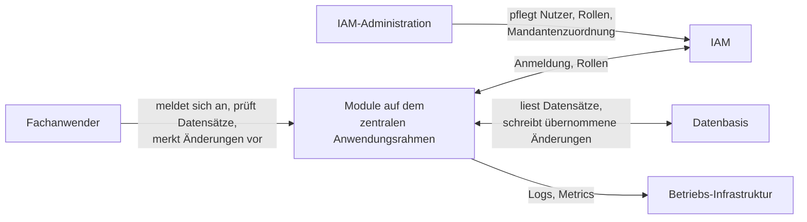

| Nachbar | Was ausgetauscht wird | Verantwortlich |
|---|---|---|
| **Fachanwender** | Anmeldung, Ansicht der Datensätze eines Mandanten, Vormerkung und Einreichung von Änderungen, Status der Massenoperation | Fachbereich |
| **IAM** | Identität, Rollen, Mandantenberechtigung (`mandant_<id>`). Einzige Vertrauensinstanz | IAM-Team |
| **Datenbasis** | Die Datensätze selbst: gelesen bei jedem Seitenwechsel, geschrieben bei übernommenen Änderungen | Datenbasis-Team |
| **Betriebs-Infrastruktur** | Logs, Metrics, Alarme; startet den Batchlauf | Betriebsteam |

**Nicht im System**: Nutzerverwaltung (2.2.12), Mandantenverwaltung (2.2.13), Haltung der Datensätze (sie bleiben auf der Datenbasis, 3.2), Deployment und Überwachung (2.1).

## 3.2 Technischer Kontext

| Nachbar | Kanal | Authentisierung | Eigenheiten |
|---|---|---|---|
| Fachanwender | HTTPS, eigene Origin je Modul | Sitzungskennung im Cookie | Kein Token im Browser (2.2.7) |
| IAM (Keycloak) | HTTPS – OIDC Authorization Code Flow mit PKCE, `userinfo`, JWKS, Back-Channel-Logout | Client-Geheimnis je Modul | Ein OIDC-Client **je Modul** (E4), damit die Audience-Prüfung greift |
| Datenbasis (Cloudera) | **JDBC-Verbindung** | eigene Kennung des Moduls | siehe unten |
| Betriebs-Infrastruktur | Logs auf stdout; Metrics, Liveness und Readiness auf eigenem, intern erreichbarem Port (8.7) | – | Die Plattform startet den Lauf (2.2.11) |

### Der Token endet an der API des Moduls

Zur Datenbasis hin meldet sich das Modul mit einer eigenen, eng berechtigten Kennung an. Es darf lesen, was es sehen soll, und nur die Spalten schreiben, die eine übernommene Änderung berührt. Der Nutzer-Token wird nicht weitergereicht; für die Datenbasis wird auch keiner beschafft. Die Berechtigung vergibt die Datenbasis, nicht das Modul.

### Die Datenbasis ist nicht die Datenbank des Moduls

Aufträge, Audit Trail und Mandantenregeln verwaltet das Modul selbst. Sie gehören in seine eigene Datenbank und nicht in die Datenbasis. Umgekehrt hält das Modul keine Kopie der Datensätze: Die Liste wird bei jedem Seitenwechsel in der Datenbasis gesucht, sortiert und geschnitten. Das ist langsamer als eine eigene Kopie, vermeidet aber einen zweiten Bestand, der unbemerkt veraltet. Dieselbe Begründung gilt für 2.2.12.

Transaktionsverhalten, Speicherform und Rückmeldungen beim Schreiben sind mit dem Datenbasis-Team abzustimmen.

## 3.3 Was der IAM je Modul bereitstellen muss

Fehlt einer dieser Punkte, startet das Modul zwar, aber Anmeldung oder Autorisierung schlagen fehl. Die Symptome sehen dann meist nach einem Fehler in der Anwendung aus.

| Punkt | Anforderung |
|---|---|
| Client | **Einer je Modul**, vertraulich (mit Geheimnis), Authorization Code Flow **mit PKCE** |
| Audience | Die Client-ID des Moduls muss im **Access-Token** stehen. Viele IAM tun das nicht von sich aus und brauchen einen eigenen Zuordner |
| Rollen | Am **userinfo-Endpunkt** verfügbar, nicht nur im Token (8.1) |
| Redirect URIs | Die Redirect URI des Moduls; in der Entwicklung zusätzlich der Port des Entwicklungsservers |
| Abmeldung | Adresse für Back-Channel-Logout je Modul (6.5) |
| Standardangaben | Kennung, Name, E-Mail müssen im Token stehen |

**Rollenmodell**: Zwei getrennte Arten von Rollen, die nie vermischt werden.

| Art | Form | Beantwortet |
|---|---|---|
| Fachrolle | frei, z. B. `user`, `admin` | *Was* darf der Nutzer tun |
| Mandantenrolle | `mandant_<id>`, ein Eintrag je Mandant | *Wo* darf er es tun |

Der Nutzerkontext (5.3) trennt beides: Er nennt nur die Fachrollen und führt die erlaubten Mandanten getrennt auf. Die Oberfläche sieht das Rollenpräfix nicht.

---

# 4. Lösungsstrategie

## 4.1 Leitgedanke

> **Ein Modul ist ein Deployment, das BFF, Oberfläche und API zugleich ist.** Alles Gemeinsame ist Bibliothek, kein Dienst.


Weil die Oberfläche von ihrem eigenen Backend ausgeliefert wird, muss CORS nichts freigeben; Token-Weitergabe über Originsgrenzen und ein Gateway-Baustein entfallen. Weil die API trotzdem nur validierte Token akzeptiert, wird auch innerhalb dieses einen Prozesses jeder Aufruf einzeln autorisiert.

## 4.2 Strategien je Qualitätsziel

| Ziel (1.2) | Ansatz | Ausgeführt in |
|---|---|---|
| Mandantentrennung | Mandant aus dem Token, bei jedem Zugriff erneut geprüft; Zugriffsregeln der Datenbank als zweite Linie | 8.2 |
| Einfachheit | Ein Bausteintyp, ein Deployment-Muster, eine Technologie-Vorgabe. Kein Gateway, kein Broker, kein zentraler Dienst | 5.1 |
| Unabhängige Module | Modul = Repository + Deployment + eigene Datenbank + eigener OIDC-Client. Kopplung nur über Bibliotheksversionen | 5.2 |
| Nahtloses Login | Jedes Modul führt seinen eigenen Anmeldevorgang; nahtlos wird er durch die Sitzung des IAM | 6.2 |
| Einheitliches Aussehen | Die Oberflächen-Bibliothek liefert Design-System und Kopfzeile – gemeinsames Erscheinungsbild ohne Laufzeitkopplung | 5.4 |
| BSI-Konformität | Token-Prüfung, Logging und Härtung sind Vorgaben der Bibliothek, nicht Fleißarbeit je Modul | 8.1, 8.4, 8.6 |

---

# 5. Bausteinsicht

## 5.1 Bausteine

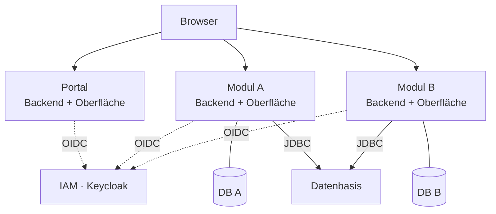

Es gibt nur einen Bausteintyp, das Modul. Auch das Portal ist ein Modul; seine Fachlichkeit ist die Modulübersicht. Fachdaten hält es keine, eine Datenbank braucht es trotzdem (2.2.3).

Ein Modul ist **ein** Deployment mit drei Aufgaben:

| Aufgabe | Umsetzung |
|---|---|
| **BFF** | Führt den OIDC Authorization Code Flow und verwaltet die Sitzung |
| **Auslieferung der Oberfläche** | Liefert das eigene gebaute Oberflächenpaket aus, unter derselben Origin wie die API |
| **API** | Stellt seine API unter dem Präfix `/api` bereit und validiert dort jeden Token vollständig (8.1) |

Das sind keine drei getrennten Rollen oder Bausteine. BFF, Oberfläche und API bleiben Teil desselben Moduls. Es gibt keine CORS-Freigaben für fremde Origins.

## 5.2 Repository-Schnitt

Jedes Modul und jede geteilte Bibliothek ist ein **eigenes Repository**. Kein Monorepo, keine gemeinsame Buildkette.

| Repository | Rolle |
|---|---|
| **Backend-Bibliothek** | Alle querschnittlichen Backend-Belange, als Abhängigkeit eingebunden (5.3) |
| **Oberflächen-Bibliothek** | Design-System und Anmeldevertrag der Oberfläche (5.4) |
| **Portal-Modul** | Launcher; Datenbank nur für die Sitzungen |
| **Fachmodul** | Je Datensatztyp eines, mit eigener Datenbank |
| **Entwicklungsumgebung** | Lokaler IAM, Datenbanken und Datenbasis |

## 5.3 Die Backend-Bibliothek

Eine gewöhnliche Bibliothek. Wer sie einbindet, hat ein plattformkonformes Modul, ohne selbst Sicherheitscode zu schreiben. Sie muss indiziert ausgeliefert werden. Andernfalls findet das Modul die enthaltenen Bausteine nicht, und sie fehlen ohne Fehlermeldung.

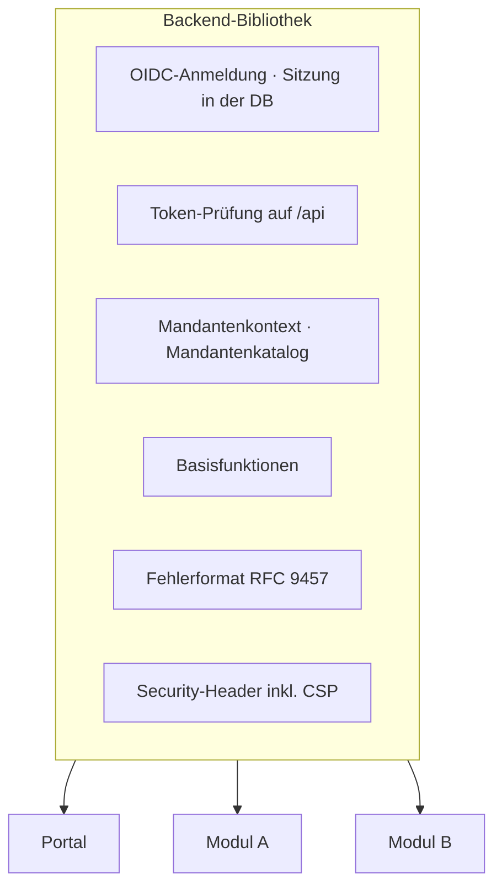

### Basisfunktionen

Drei Dinge bringt die Bibliothek jedem Modul mit. Kein Modul-Team implementiert sie, und die Oberfläche kann sich in jedem Modul auf dieselbe Form verlassen. Alle Pfade liegen unter dem Basispfad des Moduls (2.2.14); `<basis>` steht unten dafür.

| Endpunkt | Zweck | Anmeldung nötig |
|---|---|---|
| `GET <basis>/api/me` | Nutzerkontext | ja |
| `GET <basis>/api/info` | Modulinformation | ja |
| `POST <basis>/logout` | Abmeldung, vom Nutzer angestoßen | ja |
| `POST <basis>/back-channel-logout` | Gegenstelle für die Abmeldung durch das IAM | nein, siehe unten |

**Nutzerkontext** — `GET <basis>/api/me`. Wer ist angemeldet, und was darf er?

```json
{
  "subject": "8f1c…",
  "name": "Erika Mustermann",
  "email": "erika.mustermann@example.org",
  "roles": ["user", "admin"],
  "tenants": [
    { "id": "a", "name": "Mandant A" },
    { "id": "b", "name": "Mandant B" }
  ]
}
```

| Enthält | Enthält nicht |
|---|---|
| Kennung des Nutzers, Anzeigename, E-Mail | Token oder Ablaufzeit (2.2.7) |
| Fachrollen unter `roles`, ohne Mandantenrollen (3.3) | Den aktiven Mandanten; der gehört der Oberfläche (5.4) |
| Erlaubte Mandanten unter `tenants`, je mit Kürzel und Anzeigename aus dem Katalog | Fachdaten jeder Art |

Die Rollen stammen aus dem userinfo-Endpunkt des IAM und nicht aus dem Token (8.1); ein Rollenentzug wirkt deshalb ohne Neuanmeldung. Der Nutzerkontext ist **mandantenunabhängig**: Er ist für alle Mandanten des Nutzers identisch und muss beim Mandantenwechsel nicht neu geladen werden. Die Oberfläche lädt ihn einmal vor dem ersten Rendern. Ohne gültige Sitzung wird er abgewiesen, und die Oberfläche startet daraufhin die Anmeldung (8.1).

**Modulinformation** — `GET <basis>/api/info`. Welches Modul ist das, in welchem Stand?

```json
{
  "name": "demo",
  "version": "2026.07.27-build42",
  "portalUrl": "https://portal.example.org"
}
```

| Feld | Zweck |
|---|---|
| `name` | Technischer Name des Moduls, Anzeige in der Kopfzeile |
| `version` | Wird **beim Bauen** gesetzt und nicht zur Laufzeit ermittelt, damit sie nicht vom Artefakt abweichen kann. Im Support die erste Frage |
| `portalUrl` | Ziel des Zurück-Verweises; im Portal selbst leer, sonst verwiese es auf sich |

Die Angaben betreffen das Deployment, nicht den Nutzer: keine Rollen, kein Mandantenbezug, für jeden Aufrufer gleich.

**Abmeldung.** Zwei Richtungen, die nicht verwechselt werden dürfen:

| Richtung | Verhalten |
|---|---|
| `POST <basis>/logout` | Verwirft das Sitzungs-Cookie und meldet die Sitzung beim IAM ab (6.5). Muss eine ändernde Methode sein, sonst greift der Schutz aus 8.1 nicht |
| `POST <basis>/back-channel-logout` | Nimmt die Meldung des IAM entgegen, dass die Sitzung anderswo beendet wurde. Ohne Sitzung erreichbar, weil der Aufrufer das IAM ist; der Aufruf weist sich über die Signatur des Logout-Tokens aus |

Eine Funktion zum Mandantenwechsel gibt es nicht. Der Wechsel ist Sache der Oberfläche (5.4) und kein Serverzustand.

### Der Mandantenkatalog

Die Liste der Mandantenkürzel mit ihren Anzeigenamen liegt in der Bibliothek und nicht in der Konfiguration der Module. Sie ist statisch (2.2.13). Berechtigungen enthält sie nicht: Sie liefert nur Anzeigename und Reihenfolge, alles Weitere entscheiden die Rollen (8.2).

### Basispfad

Das Modul kennt seinen Basispfad erst zur Laufzeit (2.2.14). Alles, was einen Pfad bildet, muss ihn deshalb voranstellen, statt ihn fest anzunehmen:

| Betroffen | Folge, wenn der Basispfad fehlt |
|---|---|
| API-Präfix | Die Oberfläche ruft `/api` statt `<basispfad>/api` auf und landet bei einem anderen Modul oder im Nichts |
| Redirect URI und die Pfade des Anmeldevorgangs | Der Redirect vom IAM kommt nicht beim Modul an |
| Pfad des Sitzungs-Cookies | Das Cookie wird an fremde Module mitgeschickt oder gar nicht erst gesendet |
| Verweise auf Dateien und Unterseiten der Oberfläche | Das HTML-Grundgerüst lädt seine Dateien nicht |

Die Bibliotheken lösen das einmal. Ein Modul-Team setzt den Basispfad in der Konfiguration und schreibt selbst keine Pfadlogik.

### Auslieferung der Oberfläche

Zwei Regeln:

**Tiefe Verweise gehören der Oberfläche.** Ein Verweis auf eine Unterseite ist keine Datei. Der Server liefert das HTML-Grundgerüst aus, und die Oberfläche entscheidet, was sie anzeigt. Serverseitige Pfade – `/api` und die Pfade des Anmeldevorgangs – sowie Dateien sind davon ausgenommen. Sonst erhält ein Tippfehler im Skriptpfad eine Seite statt eines Fehlers, und der Fehler tritt erst viel später mit einer irreführenden Meldung auf.

**Das HTML-Grundgerüst darf nicht gecacht werden.** Die übrigen Dateien tragen einen Inhaltsstempel im Namen und dürfen beliebig lange liegen bleiben; das Grundgerüst verweist auf sie. Wird auch das Grundgerüst gecacht, lädt der Browser nach einem Release weiter die alte Oberfläche gegen das neue Backend. Das ist von außen nicht zu erkennen.

### Weiteres

| Thema | Festlegung |
|---|---|
| Fehlerformat | RFC 9457, einheitlich über alle Module und ohne interne Details nach außen |
| Datenbankschema | Versionierte Schema-Migrationen je Modul |
| Erweiterbarkeit | Fachliche Ergänzungen sind möglich. Sicherheits-, Sitzungs-, Mandanten- und Fehlerverträge sind verbindlich und nicht durch ein Modul abschaltbar |

## 5.4 Die Oberflächen-Bibliothek

Die Bibliothek wird als Quelltext ausgeliefert und vom Modul mitkompiliert. Es gibt keinen eigenen Build-Schritt und keine vorkompilierte Fassung, die veralten könnte.


| Bereich | Inhalt | Warum geteilt |
|---|---|---|
| **Design-System** | Komponentensatz mit eingelegtem Quelltext, unter freier Lizenz und mit Erweiterungspunkten für fachliche Inhalte | Einheitliches Erscheinungsbild ohne Laufzeitkopplung zwischen den Modulen |
| **App Shell** | Kopfzeile mit Modulname, Mandantenwahl, Nutzermenü, Zurück-Verweis ins Portal | Der Nutzer erkennt dieselbe Anwendung, obwohl er das Modul gewechselt hat |
| **Kachel für den Launcher** | Darstellung eines Moduls in der Übersicht | Nur vom Portal genutzt, gehört aber zum gemeinsamen Aussehen |
| **Anmeldezustand** | Lädt den Nutzerkontext vor dem ersten Rendern; wird er abgelehnt, führt er in die Anmeldung. Hält den aktiven Mandanten und baut daraus die Pfade | Kein Modul baut eigene Anmeldelogik |
| **API-Client** | Zugriff ausschließlich auf die eigene Origin, wandelt `problem+json` in typisierte Fehler | Einheitliche Fehlerbehandlung; verhindert versehentliche Fremdaufrufe |

### Der Vertrag zwischen den Bibliotheken

Die einzige Kopplung der beiden Bibliotheken ist der Nutzerkontext (5.3). Ändert sich seine Form, müssen beide Seiten neu ausgeliefert werden. Er ist deshalb klein gehalten und enthält keinen aktiven Mandanten.

### Drei Besonderheiten

**An- und Abmeldung sind Seitenwechsel, keine Hintergrundaufrufe.** Die OIDC-Redirect-Ketten müssen im Hauptfenster laufen. Ein Hintergrundaufruf würde die Redirects verschlucken, und die Anmeldung schlüge ohne Meldung fehl.

**Der Mandantenwechsel ist reiner Oberflächenzustand.** Die Auswahl wird lokal gemerkt und in den Pfad der folgenden Aufrufe geschrieben. Dafür braucht es keinen Aufruf, keine Sitzung und kein Neuladen. Das ist unbedenklich, weil der Server die Auswahl bei jedem Aufruf gegen die Rollen prüft.

**Kein Token erreicht JavaScript.** Die Oberfläche kennt weder Token noch Ablaufzeit; eine abgelaufene Sitzung erkennt sie nur daran, dass ein Aufruf abgewiesen wird. Der gesamte Sicherheitscode bleibt damit im Backend.

## 5.5 Was ausdrücklich **nicht** geteilt wird

| Nicht geteilt | Grund |
|---|---|
| Fachlogik, Domänenmodelle | Würde Module aneinander koppeln (2.2.4); jedes Modul schneidet seinen Datensatztyp selbst |
| Datenbankmodelle | Jedes Modul besitzt seine Datenbank allein (2.2.3) |

Geteilt wird, was jedes Modul gleich braucht und was nichts über Fachlichkeit weiß.

## 5.6 Modulaufbau

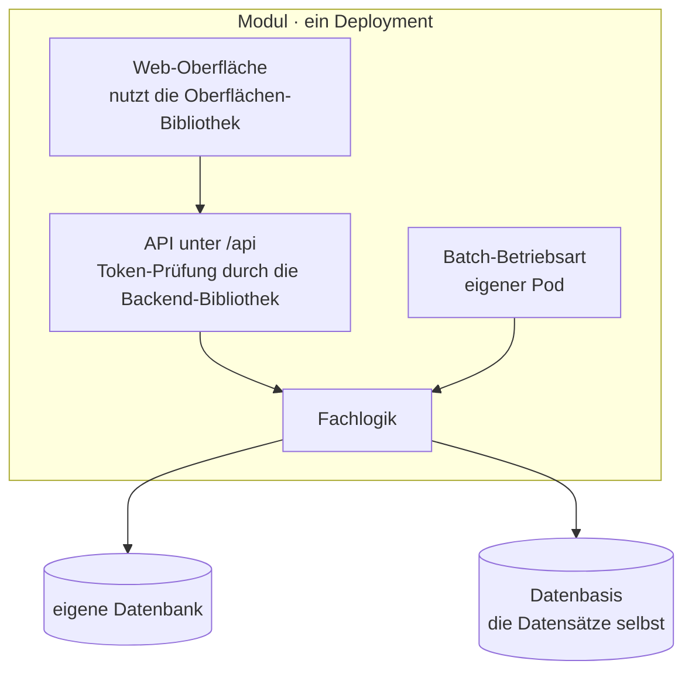

Der Batchlauf nutzt dieselbe Fachlogik wie die API, es gibt keine zweite Implementierung. Er läuft aber in einem eigenen Pod und nicht im Deployment, das die Web-Anfragen bedient (2.2.11).

## 5.7 Preis dieses Schnitts

Ohne zentralen Dienst gibt es keine Stelle, an der man einmal aktualisiert. Ein Sicherheitsfix in einer der beiden Bibliotheken erfordert ein Release jedes Moduls. Das wird bewusst in Kauf genommen (E6).

---

# 6. Laufzeitsicht

## 6.1 Anmeldung

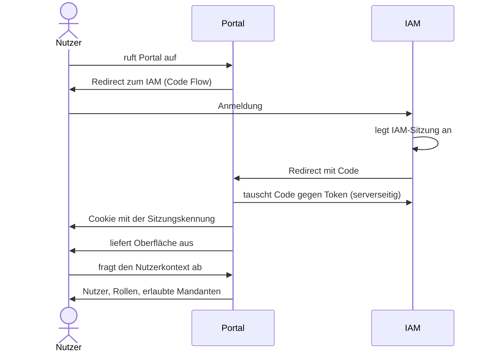

JavaScript erhält nie einen Token. Die Oberfläche rendert erst, wenn der Nutzerkontext vorliegt. Welcher Mandant aktiv ist, entscheidet sie selbst (5.4).

## 6.2 Modulwechsel und Single Sign-on

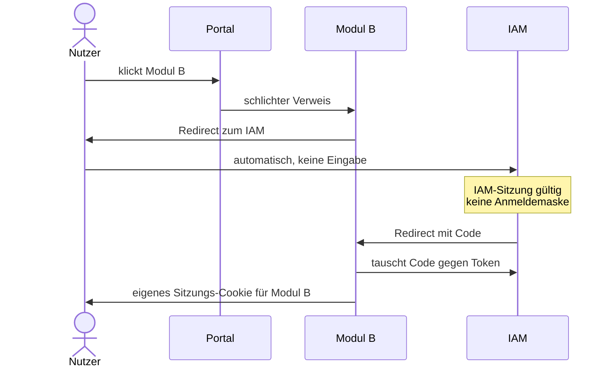

Der Nutzer sieht zwei Redirects und keinen Anmeldedialog. Single Sign-on entsteht durch die Sitzung des IAM und nicht durch einen gemeinsamen Dienst.

## 6.3 Jeder API-Aufruf

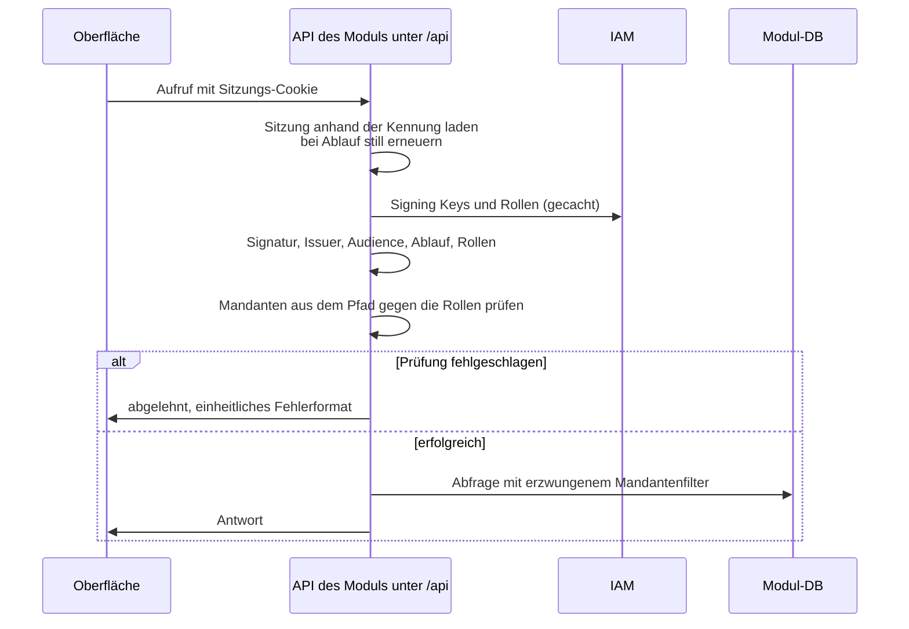

Die Sitzung liefert nur den Token. Autorisiert wird über den geprüften Token.

## 6.4 Mandantenwechsel

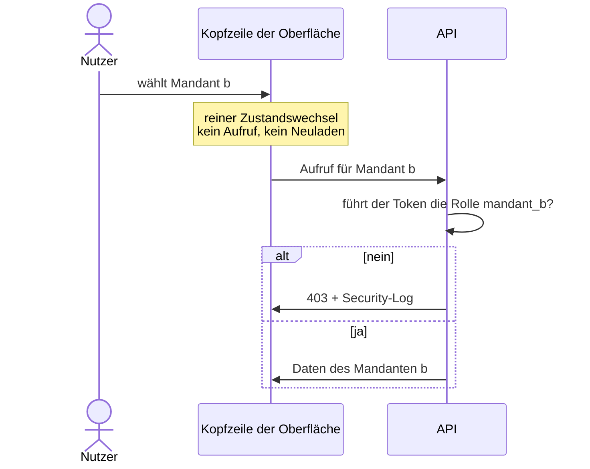

Der Wechsel selbst kostet keinen Aufruf. Antworten bleiben grundsätzlich `private`. Eine gemeinsame Caching ist nur für Endpunkte zulässig, deren Ergebnis nachweislich weder vom Nutzer noch von seinen Fachrollen abhängt.

## 6.5 Abmeldung

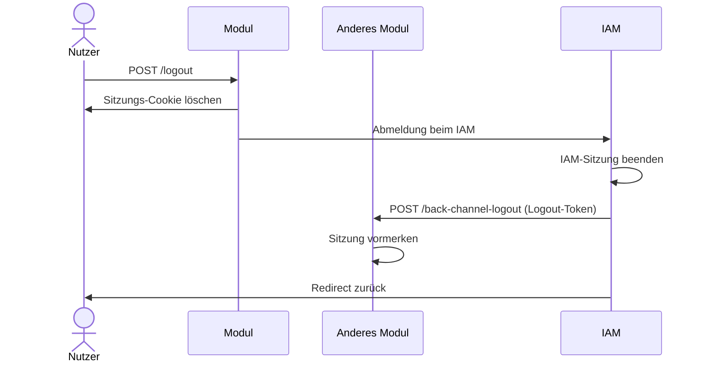

Die Abmeldung wirkt in allen Modulen. Das IAM ruft jedes beteiligte Modul direkt auf, von Server zu Server und ohne Browser. Das Modul prüft die Signatur des Logout-Tokens und **löscht die Sitzung**. Das Cookie des Nutzers zeigt danach ins Leere; der nächste Aufruf beginnt eine neue Anmeldung.

Weil die Sitzung in der Datenbank liegt, wirkt das Löschen sofort und für **alle** Replikate. Auf welches Replikat der Nutzer als Nächstes trifft, spielt keine Rolle.

---

# 7. Verteilungssicht

Jedes Modul wird als eigenständiges Artefakt ausgeliefert. Es enthält Backend und gebaute Oberfläche. Die Plattform stellt Konfiguration und Geheimnisse bereit, betreibt die Repliken und startet den Batchlauf; ein Modul enthält keinen eigenen Scheduler.

| Artefakt | Verantwortung |
|---|---|
| Modul-Artefakt | BFF, API, Fachlogik und gebaute Oberfläche |
| Datenbank je Modul | Sitzungen; in Fachmodulen zusätzlich Aufträge, Audit Trail und weiterer eigener Zustand |
| Datenbasis | Führende Datensätze; fremdbetrieben |
| Batchlauf | Eigener Pod aus demselben Modul-Artefakt, in einer expliziten Batch-Betriebsart. Wird von einem Cronjob der Plattform gestartet, läuft einmal durch und endet. Kein HTTP-Endpunkt löst die Verarbeitung aus |

Die Plattform bestimmt Termin, Parallelität und Ressourcen des Batchlaufs. Der Batch-Pod erhält dieselben Geheimnisse und Datenbankberechtigungen wie das Web-Deployment, aber keinen Browser- oder Benutzerkontext. Web-Deployment und Batch-Pod werden getrennt skaliert und können unabhängig voneinander ausfallen.

---

# 8. Querschnittliche Konzepte

Die geteilten Bibliotheken liefern die gemeinsame Mechanik für Anmeldung, Sitzung, Autorisierung, Oberfläche und Fehlerformat. Die Module setzen die fachliche Logik, die Mandantenbindung ihrer Datenbank und den Batchlauf um.

## 8.1 Anmeldung, Sitzung, Autorisierung

### Zwei Reaktionen auf eine fehlende Anmeldung

Der Browser hält ausschließlich eine Sitzungskennung; die Oberfläche erhält keinen Bearer-Token (2.2.7). Die Anmeldung läuft deshalb für alle Pfade als Authorization Code Flow. Unterschiedlich ist nicht der Mechanismus, sondern die Antwort:

| Pfad | Rolle | Verhalten bei fehlendem oder ungültigem Token |
|---|---|---|
| Aufruf unter `/api` | API | Abweisung statt Redirect. Der Redirect zum IAM wird verworfen, damit die Oberfläche die Anmeldung selbst anstoßen kann |
| Jeder andere Pfad | BFF (Code Flow) | Redirect zum IAM, danach Auslieferung der Oberfläche |

Deshalb greift die Prüfung auch innerhalb eines Moduls: Geprüft wird bei jedem Aufruf der Access-Token aus der Sitzung, nicht nur der ID-Token.

### Sitzung: Token in der Datenbank

ID-, Access- und Refresh-Token liegen in der Sitzungstabelle des Moduls (E2). Im Cookie steht nur eine Sitzungskennung, die für sich genommen nichts verrät. Die Token verlassen den Server damit nie, und die 4-KB-Grenze des Cookies spielt keine Rolle mehr. Auflagen:

| Auflage | Ohne das |
|---|---|
| Sitzungskennung zufällig und ausreichend lang | Sie ist erratbar, und Raten genügt zur Übernahme einer Sitzung |
| Kennung bei der Anmeldung neu vergeben | Session Fixation: Ein vorher untergeschobener Wert gilt nach der Anmeldung weiter |
| Abgelaufene Sitzungen regelmäßig löschen | Die Tabelle wächst unbegrenzt, und jeder Aufruf liest darin |
| Cookie-Namen je Modul verschieden | Module überschreiben sich gegenseitig die Sitzung; Cookies ignorieren Portnummern |
| `HttpOnly`, `Secure`, `SameSite=Lax` | `Lax` statt `Strict`, weil der OIDC-Redirect ein Wechsel der Origin ist |
| Keine CORS-Freigaben für fremde Origins | Fremde JavaScript-Anwendungen können API-Antworten nicht lesen; dies ist kein Ersatz für CSRF-Schutz |
| Kurze Token-Laufzeit mit stiller Erneuerung | Begrenzt das Zeitfenster eines entwendeten Cookies |
| Strenge Content-Security-Policy | XSS ist die verbleibende Hauptgefahr: Das Cookie ist für JavaScript nicht lesbar, aber mitnutzbar |

### Wenn Module sich einen Host teilen

Unter einem gemeinsamen Host mit Basispfaden (2.2.14) haben alle Module **dieselbe Origin**. Das ändert die Wirkung zweier Schutzmaßnahmen:

- Gegen **fremde** Seiten schützen `SameSite` und die fehlenden CORS-Freigaben unverändert.
- Zwischen den **Modulen selbst** trennen sie nicht mehr. Skripte im Kontext eines Moduls können Aufrufe an den Pfad eines anderen Moduls richten, und der Browser schickt dessen Cookie mit.

Die Trennung der Module ruht dann allein auf der Audience-Prüfung (weiter unten) und darauf, dass jedes Modul seinen eigenen OIDC-Client hat (E4). Beides ist ohnehin verbindlich; unter gemeinsamem Host ist es die einzige verbleibende Grenze. Ein XSS in einem Modul erreicht damit auch die APIs der übrigen Module unter demselben Host, was die Content-Security-Policy und die Prüfung der Abhängigkeiten noch wichtiger macht.

Das Sitzungs-Cookie wird auf den Basispfad des Moduls eingeschränkt und behält zusätzlich einen je Modul eindeutigen Namen. Der Pfad hält die Cookies auseinander, ist aber keine Sicherheitsgrenze.

### Content-Security-Policy

Sie ist die Gegenmaßnahme zu dem, was der Sitzungsentwurf offenlässt: Das Cookie ist für JavaScript nicht lesbar, ein eingeschleustes Skript kann aber Aufrufe im Namen des Nutzers absetzen. Teilen sich Module einen Host, trifft das auch die übrigen Module. Die Policy erlaubt deshalb nur die eigene Origin, keine fremden Skripte und keine Einbettung, und sie gilt auf jeder Antwort – auch auf der ausgelieferten Oberfläche, die an der API vorbeiläuft.

Die übrigen Security-Header sind Pflicht, aber nicht plattformspezifisch; sie stehen als Anforderung in 8.6.

### CSRF ohne Token

Die Oberfläche sendet ändernde Aufrufe ausschließlich per `fetch` als JSON. Der Server akzeptiert für solche Endpunkte nur Nicht-GET-Methoden mit `Content-Type: application/json` und weist einfache Formular-Inhalte (`application/x-www-form-urlencoded`, `multipart/form-data`, `text/plain`) ab. Damit kann eine fremde HTML-Form keinen gültigen Änderungsaufruf bilden.

Zusätzlich prüft der Server bei ändernden Browser-Aufrufen `Sec-Fetch-Site` und akzeptiert nur `same-origin`. Das Sitzungs-Cookie mit `SameSite=Lax` bleibt eine weitere Schutzschicht; ändernde Operationen dürfen nie über GET oder eine Methodenüberschreibung erreichbar sein. Der CORS-Filter erteilt keiner fremden Origin Leserechte, ist aber **kein** eigener CSRF-Schutz.

### Rollen aus dem userinfo-Endpunkt

Rollen werden am userinfo-Endpunkt erfragt und nicht aus dem Token gelesen. Ein Entzug wirkt dadurch, ohne dass der Token ablaufen muss. Die Antwort wird kurz gecacht, sonst kostet jeder Aufruf eine IAM-Anfrage. Das Benutzerobjekt wird je Request daraus gebaut und nie gespeichert (2.2.12).

### Prüfreihenfolge

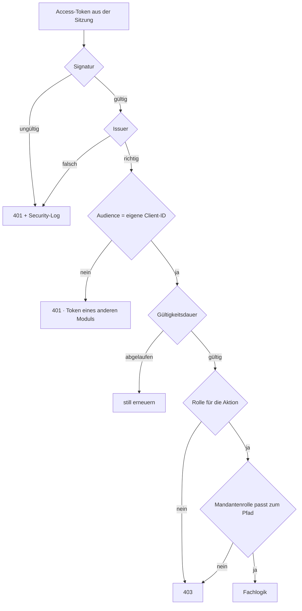

| Schritt | Erfahrungswert |
|---|---|
| **Audience prüfen** | Der am häufigsten übersehene Schritt. Ohne ihn ist ein Token von Modul A auch bei Modul B gültig, und die Trennung der Module ist aufgehoben. Im IAM ist dafür ein eigener Zuordner je Client nötig; fehlt er, wird jeder Token abgelehnt. Negativtest im Build verankern |
| **Signing Keys cachen** | Ohne Cache erzeugt jeder Aufruf eine IAM-Anfrage. Neuladen nur bei unbekanntem Schlüsselkennzeichen, sonst bricht die Key Rotation alle Module auf einmal |
| **Clock-Skew-Toleranz** | Ohne Toleranz führt geringer Clock Skew zu sporadischen 401, die sich nicht reproduzieren lassen |
| **Signaturverfahren festnageln** | Nie aus dem Token übernehmen |

## 8.2 Mandantentrennung

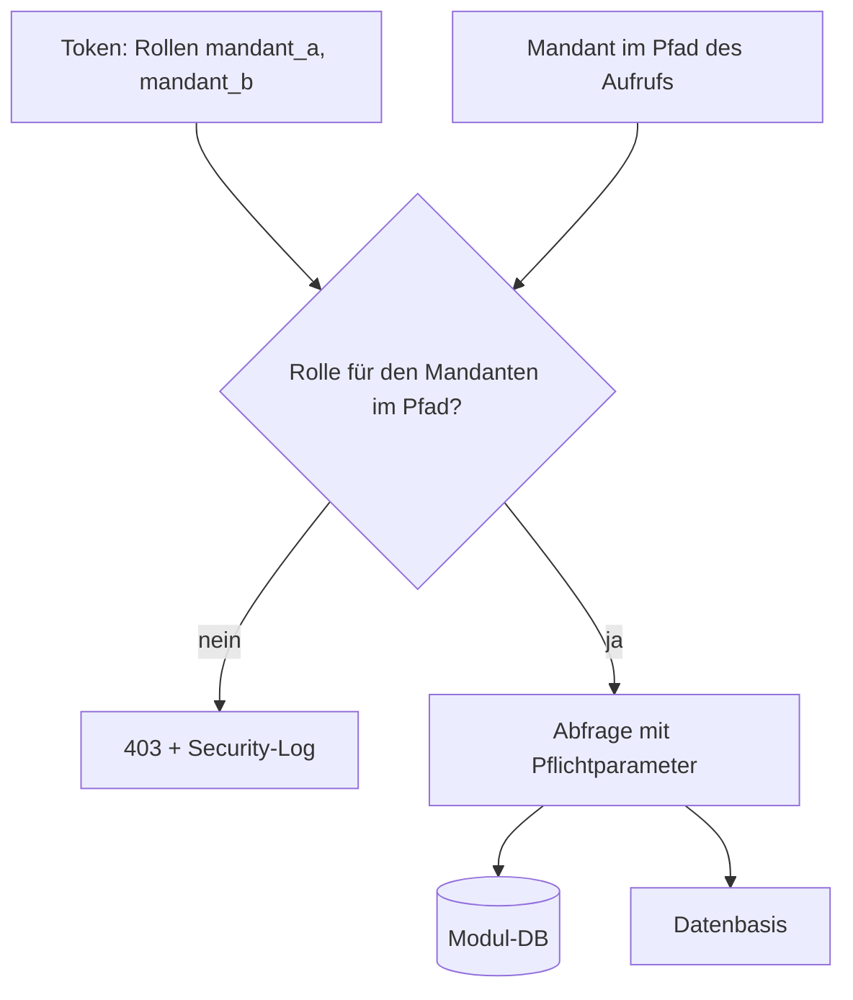

Der Mandant steht im Pfad und nicht im Serverzustand. Das ist die Voraussetzung für Caching: Jede Antwort hat einen eigenen Schlüssel, und kein Cache muss ein Cookie auswerten.

- Quelle der Wahrheit ist der **Token**: Der Mandant kommt aus dem Browser, gilt aber nur, wenn der Token die Rolle `mandant_<id>` führt. Die Oberfläche wählt ihn aus, der Server übernimmt ihn nicht ungeprüft.
- Der Mandant ist Pflichtparameter jeder Abfrage. Ein Aufruf ohne ihn schlägt fehl, statt versehentlich alles zu liefern.
- Mandantenbezogene Aufrufe führen das Mandantenkürzel im Pfad unter `/api`.
- Das Mandantenkürzel (2.2.13) ist Pflichtspalte jeder mandantenbezogenen Tabelle und erste Spalte jedes Index.

### Zweite Verteidigungslinie in der Datenbank

Ein Filter im Anwendungscode wird irgendwann in einer neuen Abfrage vergessen, meist weil die Regel nicht bekannt war. Deshalb erzwingt die Datenbank sie zusätzlich über Row Level Security (E9):

| Regel | Wirkung |
|---|---|
| Zugriffsregel je Tabelle aktiv | Ein vergessener Filter liefert keine Zeilen statt aller. Aus einem unbemerkten Datenabfluss wird ein sichtbarer Fehler |
| Regel auch für den Eigentümer erzwingen | Sonst umgeht ausgerechnet der Anwendungsbenutzer sie |
| Anwendung verbindet sich **unprivilegiert** | Ein Datenbank-Superuser umgeht die Regeln bedingungslos. Die zweite Linie wäre abgeschaltet, während alle Tests grün bleiben |
| Mandant **je Transaktion** setzen, nicht je Verbindung | Bei Connection Pooling bliebe er sonst an der Verbindung hängen, und der nächste Nutzer erbte ihn. Das ist die gefährlichste Ausprägung dieses Fehlers |
| Negativtest im Build | Abfrage ohne gesetzten Mandanten muss leer bleiben |

**Wie der Mandant an die Datenbank kommt**: Die Anwendung setzt ihn zu Beginn jeder Transaktion in eine **transaktionsgebundene** Variable; die Zugriffsregel jeder Tabelle vergleicht die Mandantenspalte damit. Die Transaktionsbindung ist entscheidend: An der Verbindung gebunden überlebt der Wert die Rückgabe in den Pool, und der nächste Nutzer erbt ihn. Ist die Variable nicht gesetzt, liefert jede Abfrage null Zeilen. Das prüft der Negativtest.

Reichweite: Diese zweite Linie liegt in der Datenbank des Moduls und schützt nur, was dort liegt, also Aufträge und Audit Trail. Die Datensätze selbst liegen auf der Datenbasis, die keine solchen Regeln kennt. Für sie tragen zwei andere Dinge: der Mandant als Pflichtprädikat jeder Abfrage und die Berechtigung des Modul-Prinzipals auf der Plattform (3.2). Wer die Trennung dort ebenso zweifach absichern will, muss das mit dem Plattform-Team vereinbaren.

## 8.3 Massendaten

Große Datenmengen werden nicht im Request verarbeitet (2.2.11). Der Aufruf nimmt den Wunsch entgegen und antwortet sofort. Verarbeitet wird er später in einem eigenen Pod, den ein Cronjob der Plattform startet. Es ist dasselbe Artefakt in einer Batch-Betriebsart, aber nicht dasselbe laufende Deployment: Das Deployment, das die Web-Anfragen bedient, führt keine Massenverarbeitung aus. Ein Broker steht nicht zur Verfügung (2.2.10).

Folgende Regeln gelten plattformweit, alles Weitere entscheidet das Modul:

| Regel | Warum |
|---|---|
| Die Plattform startet den Lauf | Kein Scheduler im Prozess und kein Endpunkt, der Arbeit auslöst. Wann und wie oft, entscheidet die Plattform |
| Der Lauf ist von der Mandantentrennung nicht ausgenommen | Er unterliegt denselben Zugriffsregeln wie ein Nutzeraufruf (8.2) |
| Verarbeitung ist idempotent | Ein wiederholter Start darf einen Auftrag nicht doppelt an die Datenbasis übergeben |
| Auftrag wird exklusiv beansprucht | Parallele Läufe dürfen denselben Auftrag nicht zugleich bearbeiten |
| Fehler bleiben sichtbar | Fehlgeschlagene Aufträge bleiben mit Fehlerursache und Zeitstempel erhalten; ein späterer Lauf kann sie nach fachlicher Freigabe erneut versuchen |

Die Modul-Datenbank und die Datenbasis teilen keine Transaktion. Jede Übergabe an die Datenbasis braucht daher einen stabilen Idempotenzschlüssel oder eine fachlich idempotente Schreiboperation. Erst nach bestätigter Übergabe darf der Auftrag als erfolgreich gespeichert werden. Bei jedem Auftrag setzt der Lauf den gespeicherten Mandanten erneut und transaktionsgebunden, genau wie ein Nutzeraufruf (8.2).

## 8.4 Logging und Metrics

| Ebene | Inhalt | Ziel |
|---|---|---|
| Audit | Wer, wann, welcher Mandant, welcher Datensatz, welche Aktion | Nur ergänzbare Tabelle je Modul |
| Sicherheit | Abgelehnte Anmeldungen und Mandantenzugriffe, ungültige Token | Eigener Logger → Betriebs-Infrastruktur (OPS.1.1.5, DER.1) |
| Betrieb | Fehler, Antwortzeiten, Ergebnisse der Batchläufe | Logs und Metrics → Überwachung |

Keine Token und keine personenbezogenen Nutzdaten in den Logs. Die Correlation ID von Anfang an durchreichen; nachträglich ist das aufwendig.

## 8.5 Fehler und Schnittstellen

Einheitliches Fehlerformat nach RFC 9457 (`problem+json`), in der Oberfläche als typisierter Fehler verfügbar. Nach außen gehen nur allgemeine Meldungen mit Correlation ID, keine internen Details (BSI APP.3.1).

REST/JSON unter `/api`, ohne Versionsangabe im Pfad. Jede Oberfläche wird von ihrem eigenen Backend ausgeliefert, beide gehen also immer gemeinsam in Betrieb. Es gibt keinen fremden Aufrufer, für den eine alte Fassung offen bleiben müsste. Wird später eine Schnittstelle für Dritte geöffnet, ist die Pfadversionierung dort nachzurüsten.

Modulübergreifende Schnittstellen gibt es nicht; nur Oberfläche ↔ eigenes Backend und Backend ↔ Datenbasis (3.2).

## 8.6 Sicherheit im Betrieb

| Maßnahme | BSI |
|---|---|
| TLS-Zwang und Security-Header am Eingang | APP.3.1 |
| Netztrennung je Modul, kein Weg von Modul zu Modul | NET.1.1, APP.4.4 |
| Container ohne Root, ohne Zusatzrechte, mit schreibgeschütztem Dateisystem | SYS.1.6 |
| Geheimnisse getrennt von der Konfiguration, rotierbar | ORP.4 |
| Schwachstellenprüfung des Artefakts vor Betriebsübergabe | CON.8 |
| Datenbankbenutzer nur auf dem eigenen Schema berechtigt, ohne Superuser-Rechte | ORP.4 |

## 8.7 Liveness und Readiness

Die Laufzeitumgebung muss zwei Fragen selbst beantworten können. Erstens: Lebt der Prozess noch? Wenn nicht, wird er neu gestartet. Zweitens: Darf er Aufrufe bekommen? Wenn nicht, wird er aus dem Verkehr genommen. Beide Auskünfte liefert das Modul; ausgewertet werden sie vom Betriebsteam (2.1).

| Auskunft | Beantwortet |
|---|---|
| Liveness | Läuft der Prozess noch? Antwortet, solange er überhaupt bedienbar ist |
| Readiness | Darf dieser Pod Aufrufe bekommen? Prüft die eigene Datenbank und die Erreichbarkeit des IAM |

Beide liegen auf dem **Management-Port** und nicht unter `/api`, damit sie ohne Anmeldung erreichbar sind, ohne nach außen zu zeigen.

| Regel | Warum |
|---|---|
| Auskunft auf einem **eigenen Port**, der nicht nach außen veröffentlicht wird | Die Laufzeitumgebung hat keine Sitzung. Läge die Auskunft hinter der Anmeldung, käme sie nie an sie heran; auf dem öffentlichen Port ohne Anmeldung wäre sie ein Informationsleck. Ein interner Port löst beides |
| **Liveness prüft nichts außer sich selbst** | Prüft sie Abhängigkeiten mit, startet eine kurze Datenbankstörung reihenweise Container neu. Aus einer Störung wird ein Ausfall |
| **Readiness prüft nur, was das Modul zum Antworten braucht** | Die eigene Datenbank und die Erreichbarkeit des IAM. Ohne sie kann das Modul nichts Sinnvolles tun |
| **Readiness prüft die Datenbasis nicht** | Sie ist fremdbetrieben (3.2). Hinge die Readiness an ihr, nähme eine Störung dort alle Module gleichzeitig aus dem Verkehr. Ohne diese Kopplung fällt nur die Anzeige der Datensätze aus; Anmeldung, Portal, Mandantenwahl und bereits Vorgemerktes bleiben bedienbar |
| Der Batch-Pod braucht keine Readiness | Er nimmt keine Aufrufe an. Ob er erfolgreich war, sagt sein Exit-Code (8.3) |

Eine Readiness-Prüfung, die jede fremde Abhängigkeit mitprüft, macht aus einer fremden Störung einen eigenen Totalausfall.

## 8.8 Rate Limiting

Begrenzt wird nicht in erster Linie zum Schutz des Moduls, sondern zum Schutz der Systeme dahinter.

| Begrenzt wird | Warum |
|---|---|
| Aufrufe, die die Datenbasis belasten (Suchen, Blättern) | Jede Seite ist dort eine teure Abfrage (3.2). Ein einzelner Nutzer kann ein fremdbetriebenes System spürbar belasten |
| Der Anmeldevorgang | Der einzige Pfad, der ohne Sitzung erreichbar ist |

Die Grenzen gelten **je Nutzer und Mandant**, nicht je IP-Adresse: Alles außer dem Anmeldevorgang liegt hinter der Anmeldung, und mehrere Nutzer teilen sich oft eine IP-Adresse. Wird eine Grenze überschritten, antwortet das Modul mit `429` und einem `Retry-After`; die Oberfläche zeigt das als Hinweis und nicht als Fehler.

**Grenze der Umsetzung im Modul**: Container sind zustandslos, und ein geteilter Zählerspeicher steht nicht zur Verfügung (2.2.9, 2.2.10). Ein Zähler im Prozess begrenzt deshalb je Replik und nicht global; die tatsächliche Grenze ist das Vielfache der konfigurierten. Entweder wird das bei der Festlegung der Werte eingerechnet, oder die Begrenzung gehört an den Eingang der Plattform, wo sie zentral vorhanden ist.

---

# 9. Architekturentscheidungen

## 9.1 Übersicht

| # | Entscheidung | Gewählt |
|---|---|---|
| E1 | Frontend-Integration | Portal als Launcher, Verweise statt Micro-Frontends |
| E2 | Sitzung | Token in der Datenbank des Moduls, Cookie trägt nur eine Kennung |
| E3 | Eingangskomponente | Keine, das Modul liefert seine Oberfläche selbst aus |
| E4 | OIDC-Clients | Einer je Modul |
| E5 | Mandantenkontext | Aus dem Token, Auswahl in der Oberfläche |
| E6 | Geteiltes | Bibliotheken statt Dienste |
| E7 | Asynchronität | Massendaten verschoben statt im Request verarbeitet |
| E8 | Abmeldung | RP-initiated plus Back-Channel-Logout |
| E9 | Zweite Linie Mandantentrennung | Row Level Security in der Datenbank |
| E10 | Betriebsmodell | Alle Module sind betrieblich identisch; Abweichungen sind nicht Sache des Modul-Teams |
| E12 | Öffentliches UI-Framework | KoliBri nicht einsetzen, stattdessen ein erweiterbares Design-System |

Alle entschieden.

## 9.2 Im Einzelnen

### E1 — Portal als Launcher

Micro-Frontends erzeugen Laufzeitkopplung und Versionsabhängigkeiten zwischen Hülle und Modulen, was unabhängigen Releases widerspricht. Der Preis ist ein spürbarer Anwendungswechsel. Die gemeinsame Kopfzeile aus der Oberflächen-Bibliothek gleicht ihn weitgehend aus.

### E2 — Token in der Datenbank

Ein verteilter Sitzungsspeicher steht nicht zur Verfügung (2.2.10), eine Datenbank je Modul dagegen schon (2.2.3). Die Token liegen deshalb in einer Sitzungstabelle des Moduls, und das Cookie trägt nur eine zufällige Kennung.

Das löst drei Dinge auf einmal:

| | |
|---|---|
| Kein Token im Browser | Die Token verlassen den Server nicht (2.2.7). Ein entwendetes Cookie ist eine Sitzungskennung, kein Token |
| Abmeldung wirkt sofort | Die Sitzung wird gelöscht und gilt damit auf allen Replikaten nicht mehr (E8). Ein Vermerk über abgemeldete Sitzungen erübrigt sich |
| Keine Größengrenze | Die 4-KB-Grenze des Cookies entfällt, ebenso das Aufteilen großer Cookies und der über alle Replikate gleiche Verschlüsselungsschlüssel |

Die Container bleiben zustandslos im Sinne von 2.2.9: Der Zustand liegt in der Datenbank, nicht im Prozess, und jedes Replikat sieht dieselbe Sitzung.

**Preis**: Jeder Aufruf liest die Sitzung aus der Datenbank, und die Datenbank wird zur Voraussetzung der Anmeldung. Fällt sie aus, kommt niemand mehr hinein, während die Anmeldung mit Token im Cookie noch funktioniert hätte. Abgelaufene Sitzungen müssen aufgeräumt werden (8.1).

**Verworfen**: Token verschlüsselt im Cookie. Das kam ohne Datenbank aus, ließ aber das Token im Browser, brauchte einen über alle Replikate gleichen Verschlüsselungsschlüssel und machte eine sofort wirkende Abmeldung unmöglich.

### E3 — Keine Eingangskomponente

Jedes Modul liefert seine Oberfläche selbst aus. Damit teilen Oberfläche und API dieselbe Origin: keine Freigabe fremder Origins nötig, kein Gateway, ein Baustein weniger. Ein Gateway hätte keine eigene Aufgabe, da die Autorisierung ohnehin je Modul stattfindet.

### E4 — Ein OIDC-Client je Modul

Zwingende Folge aus E3. Nebeneffekt: saubere Trennung der Audience, wodurch die Prüfung aus 8.1 überhaupt erst greifen kann, sowie klare Rechte- und Protokollzuordnung je Modul.

**Preis**: Das IAM-Team wird bei jedem neuen Modul tätig. Erfordert Standardvorlage und feste Vorlaufzeit.

### E5 — Mandant aus dem Token

Kein eigener Mandantendienst. Der IAM ist ohnehin Vertrauensinstanz; zwei Quellen der Wahrheit wären ein Risiko. Die Auswahl merkt sich allein die Oberfläche.

**Preis**: Änderungen an der Zuordnung wirken erst, wenn die Rollen neu erfragt werden. Der userinfo-Cache (8.1) hält die Verzögerung bei Minuten statt bei der Token-Laufzeit.

### E6 — Bibliotheken statt Dienste

Jeder zentrale Dienst wäre Betriebsgegenstand, Ausfallpunkt und weitere Vertrauensgrenze zugleich. Bei getrenntem Betrieb (2.1) wiegt das schwerer als Wiederverwendung zur Laufzeit.

**Preis**: Ein Sicherheitsfix erfordert ein Release jedes Moduls. Eine verbindliche Mindestversion mit Frist hält die Module beieinander.

### E7 — Massendaten verschoben

Kein Broker verfügbar (2.2.10), und ein Request darf nicht auf eine Massenverarbeitung warten. Der Wunsch wird deshalb entgegengenommen und später abgearbeitet. Die Verarbeitung startet zum nächsten Termin statt sofort; bei kurzen Intervallen fällt das nicht ins Gewicht.

### E8 — Abmeldung

Die Abmeldung wird vom Modul beim IAM angestoßen und um Back-Channel-Logout ergänzt. Das IAM ruft jedes Modul direkt auf, sodass eine Abmeldung überall wirkt und nicht nur dort, wo sie ausgelöst wurde.

Das Modul löscht dabei die Sitzung in seiner Datenbank (E2). Die Abmeldung wirkt dadurch sofort und auf allen Replikaten, nicht nur auf dem, das das IAM zufällig aufgerufen hat.

**Preis**: Auch ein Modul ohne Fachdaten braucht dafür eine Datenbank, das Portal eingeschlossen (2.2.3).

### E9 — Zugriffsregeln in der Datenbank

Der Filter im Anwendungscode allein reicht nicht, weil er irgendwann in einer neuen Abfrage übersehen wird. Zeilenbasierte Regeln machen aus einem unbemerkten Datenabfluss einen sichtbaren Fehler. Beim wichtigsten Qualitätsziel ist eine zweite Linie den Aufwand wert.

### E10 — Alle Module sind betrieblich identisch

Ein separates Betriebsteam rollt jedes Modul aus, überwacht es und hat die Rufbereitschaft (2.1). Es kennt die Fachlichkeit der Module nicht und soll für alle dieselben Handgriffe verwenden. Deshalb ist nicht nur das Ergebnis vorgegeben, sondern die Form:

| Gleich in jedem Modul | Konkret |
|---|---|
| Artefakt | Eines je Modul, Backend und gebaute Oberfläche enthalten (7) |
| Start | Web-Deployment ohne Argumente; der Batchlauf ist ein eigener Pod desselben Artefakts mit einem zusätzlichen Startparameter (2.2.11) |
| Konfiguration | Dieselben Schlüssel mit derselben Bedeutung in jedem Modul, Geheimnisse davon getrennt (8.6) |
| Betriebsauskünfte | Liveness, Readiness, Logs und Metrics an derselben Stelle und im selben Format (8.4, 8.7) |
| Schema-Migrationen | Laufen automatisch mit dem Modul, nicht als getrennter Schritt, den jemand kennen müsste |
| Fehlerbild | Dieselben Statuscodes und dasselbe Fehlerformat (8.5) |

Ein Modul-Team darf davon nicht abweichen, auch wenn es für sein Modul bequemer wäre. Jede Abweichung erzeugt Sonderwissen, das ein Team aufbauen müsste, das den Code nicht geschrieben hat.

### E12 — KoliBri nicht als Design-System einsetzen

KoliBri wird nicht als öffentliches UI-Framework der Oberflächen-Bibliothek eingesetzt. Seine Web Components sind für die vorgesehenen Fachoberflächen zu starr: Sie nehmen bei Tabellen im Wesentlichen Daten entgegen, bieten aber keinen ausreichend flexiblen Erweiterungspunkt für fachliche Inhalte pro Zeile.

Ein konkreter Bedarf ist eine Aktionsschaltfläche in einer Tabellenzeile. Diese muss vom Modul fachlich bestimmt und mit eigener Aktion verbunden werden können. Lässt die Tabellen-Komponente nur Daten übergeben, aber weder eine Zelle noch Zeilenaktionen erweitern, müsste das Modul die Tabelle umgehen oder nachbauen. Beides zerstört entweder das gemeinsame Erscheinungsbild oder macht die Bibliothek wirkungslos.

Das gewählte Design-System muss deshalb neben einem freien Lizenzmodell auch komponentennahe Erweiterungspunkte bieten, insbesondere Templates, Slots oder vergleichbare Render-Hooks für Zellen und Zeilenaktionen. Einheitlichkeit bleibt Ziel; sie darf nicht durch einen unflexiblen Komponentensatz gegen fachliche Erweiterbarkeit eingetauscht werden.

**Preis**: Ein flexiblerer Komponentensatz erhöht die Verantwortung der Oberflächen-Bibliothek, Vorgaben für Aussehen, Bedienbarkeit und Barrierefreiheit der Erweiterungspunkte zu machen.

---

# 10. Qualitätsszenarien

Diese Szenarien sind verbindliche Abnahmekriterien für jedes Modul. Sie ergänzen die Unit- und Fachtests des jeweiligen Moduls.

| Qualitätsziel | Szenario | Erwartung |
|---|---|---|
| Modultrennung | Access Token von Modul A an die API von Modul B senden | `401`; die Audience des Tokens wird geprüft |
| Mandantentrennung | Aufruf für einen Mandanten ohne passende Rolle | `403` und Sicherheitsprotokollierung |
| Zweite Datenbanklinie | Datenbankabfrage ohne gesetzten Mandanten | Keine Zeile; der Test läuft im Build gegen den unprivilegierten Anwendungsbenutzer |
| SSO | Nach Anmeldung im Portal ein weiteres Modul öffnen | IAM leitet zurück, ohne eine Anmeldemaske zu zeigen |
| CSRF | Fremde Seite sendet eine einfache Formularanfrage an einen ändernden Endpunkt | Keine Änderung; der Endpunkt akzeptiert weder einfachen Formularinhalt noch einen fremden Browser-Kontext |
| Batch | Plattform startet denselben Batchlauf erneut | Bereits erfolgreich übergebene Aufträge werden nicht doppelt verarbeitet |
| Abmeldung | Abmeldung in einem Modul, danach Aufruf eines anderen Moduls auf einem anderen Replikat | Keine gültige Sitzung mehr; der Nutzer wird neu angemeldet |

---

# 12. Glossar

| Begriff | Bedeutung |
|---|---|
| **Zentraler Anwendungsrahmen** | Die beiden geteilten Bibliotheken, die jedes Modul einbindet – kein laufender Dienst |
| **Modul** | Ein Deployment, das BFF, Oberfläche und eigenständig prüfende API zugleich ist. Der einzige Bausteintyp (5.1) |
| **Portal** | Modul, dessen Fachlichkeit die Modulübersicht ist. Ohne Datenbank |
| **BFF** | Backend for Frontend: die serverseitige Hälfte der Anmeldung. Führt den Code Flow, hält die Token und gibt sie nie an JavaScript |
| **Autorisierung je Aufruf** | Keine Anwendung vertraut einer anderen; autorisiert wird ausschließlich über einen vollständig geprüften Token, nie über die Sitzung (2.2.5) |
| **Mandant** | Die Datentrennungseinheit. Statisch, mit festem Kürzel; im IAM eine Rolle, in der Datenbank der Wert der Mandantenspalte (2.2.13) |
| **Mandantenkatalog** | Feste Liste der Mandantenkürzel mit Anzeigename und Reihenfolge, in der Backend-Bibliothek (5.3). Vergibt keine Rechte |
| **Aktiver Mandant** | Der gerade betrachtete Mandant – reiner Zustand der Oberfläche, nie Serverzustand (5.4) |
| **Audience** | Die Client-Kennung, für die ein Token ausgestellt wurde. Ihre Prüfung ist der am häufigsten übersehene Schritt (8.1) |
| **Issuer** | Der IAM, der den Token ausgestellt hat |
| **Vormerkung** | Eine gewünschte, noch nicht eingereichte Änderung. Gehört bis zum Einreichen dem Nutzer |
| **Auftrag** | Eine eingereichte Änderung; ab hier gehört sie dem Lauf |
| **Batchlauf** | Verarbeitung außerhalb des Requests, in einem eigenen Pod, den ein Cronjob der Plattform startet (8.3) |
| **Audit Trail** | Nur ergänzbarer Nachweis je Modul: wer, wann, welcher Mandant, welcher Datensatz, welche Aktion (8.4) |
| **Row Level Security** | Zweite Linie der Mandantentrennung in der Datenbank (E9) |
| **Datenbasis** | Führende Quelle der Datensätze. Cloudera, über eine JDBC-Verbindung angebunden, ohne OIDC (3.2) |
| **Datensatz** | Ein Eintrag des Datensatztyps, den ein Modul bedient. Liegt auf der Datenbasis, nie als Kopie im Modul |
| **IAM** | Identity and Access Management – die einzige Vertrauensinstanz (2.2.6) |
| **Basisfunktionen** | Nutzerkontext, Modulinformation und Abmeldung; was jedes Modul durch die Backend-Bibliothek automatisch mitbringt (5.3) |
| **Fehlerformat** | Einheitliches Fehlerformat über alle Module nach RFC 9457 (8.5) |
| **ISB** | Informationssicherheitsbeauftragter; prüft die Umsetzung der BSI-Anforderungen (8.6) |
